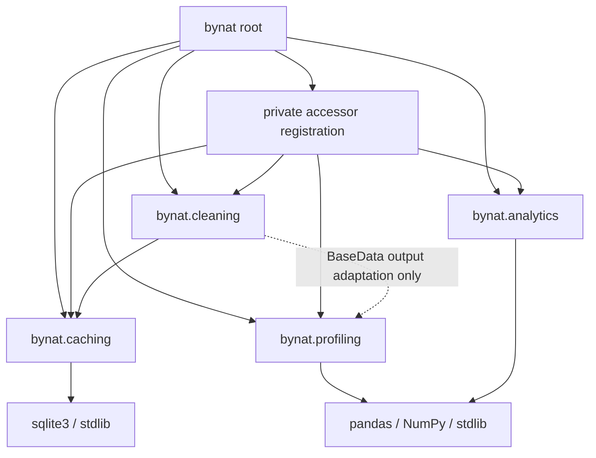
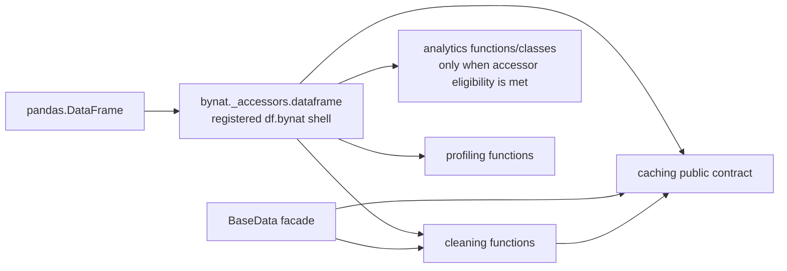

# bynat Architecture Research

**Task:** ARCH-03 / Issue #62
**Repository snapshot:** historical research snapshot at commit `b5ac64a` (`docs: research package architecture`), branch `arch-module`, package version `0.6.6`
**Phase 0 baseline:** commit `b2a5f43` (`Add architecture refactoring plan for bynat`), branch `arch-module`; see the Phase 0 section below
**Research date:** 2026-11-21
**Scope:** architecture research and documentation only. No production implementation is proposed as part of this document.

> **Evidence labels used below**
>
> - **Verified fact** — directly observed in the local checkout, generated from the local source tree, or confirmed by an executed command.
> - **External evidence** — a finding supported by an explicitly linked external source.
> - **Interpretation** — an architectural conclusion drawn from the verified facts and external evidence.
> - **Recommendation** — a proposed future direction; it is not current implementation.

> **Phase 2 status update (implemented).** The accessor integration boundary has
> moved to `bynat/_accessors/dataframe.py` (binding helpers in
> `bynat/_accessors/_binding.py`), with the generated stub at
> `bynat/_accessors/dataframe.pyi`; `bynat/cleaning/accessor.py` and
> `bynat/cleaning/accessor.pyi` are removed. Sections below that describe the
> accessor under `cleaning/` record the pre-Phase-2 baseline used for the
> research measurements; current-state sections have been updated.

> **Phase 3 status update (implemented).** The root initializer now explicitly
> imports `analytics`, `caching`, `cleaning`, and `profiling`, imports
> `_accessors` for registration only, and imports the canonical `read_csv` and
> `read_json` loader functions from `bynat.cleaning.io`. It declares `__all__`
> as exactly the six names `cleaning`, `caching`, `analytics`, `profiling`,
> `read_csv`, `read_json`, in that order. The obsolete root exports
> `BynatAccessor`, `ProfileReport`, and `profile` are removed. Sections below
> that describe the earlier four-name contract or the five removed names as
> current record the pre-adjustment baseline; current-state sections describe
> the implemented six-name root API. The Phase 0.2/0.3 four-name root target is
> the historical Phase 0 baseline and is superseded by that implemented
> six-name API; those sections are retained unchanged as historical record.

## Executive conclusion

`bynat` is already a small **modular monolith** using the **Functional Core + Facades** direction established by ARCH-02. Its strongest architectural property is that the reusable DataFrame operations live below two integration surfaces:

1. the supported `BaseData` / `JsonFile` / `CsvFile` class facade; and
2. the optional `df.bynat` pandas accessor facade.

The current package boundaries are mostly sound, but the clarified public-initialization decision adds a fourth intended public package entry point, `bynat.profiling`:

- `bynat.cleaning` owns DataFrame cleaning, enrichment, and I/O functions plus the supported class facade;
- `bynat.caching` owns persistent cache storage and migration independently of cleaning;
- `bynat.analytics` owns application-independent analytics and currently has no internal `bynat` dependency;
- `bynat.profiling` is approved to own non-mutating data-quality inspection and structured profile reports (see the Phase 0 section).

The main architectural issue was not that the repository lacks more directories. It was that `bynat/cleaning/accessor.py` was a library-wide integration boundary located inside one functional package, while it delegated across cleaning and caching and was the likely future home of analytics-facing methods. The approved direction was a thin `bynat/_accessors/` integration package, introduced in the plan's Phase 2 after import behavior and contract tests settled. Phase 2 has since executed: the accessor now lives in `bynat/_accessors/dataframe.py` with binding helpers in `bynat/_accessors/_binding.py` and the generated stub `bynat/_accessors/dataframe.pyi`. The accessor remains a facade; algorithms stay in their functional modules.

A previous task version described the root initializer as empty. The current clarification supersedes that wording: the intended root API is the four package entry points (`cleaning`, `caching`, `analytics`, `profiling`) plus the canonical `read_csv`/`read_json` loader functions and the registered `df.bynat` capability, without exposing internal classes or other implementation objects directly. Phase 3 has executed that contract: the root initializer explicitly binds the four package entry points and the two loader functions, imports the private accessor registration boundary for its side effect, and no longer exposes `BynatAccessor`, `ProfileReport`, or `profile` as root names. This report treats the clarified contract as the implemented target; previous-version compatibility is out of scope (see the Phase 0 section).

The evidence does **not** justify:

- making `analytics` depend on `cleaning`;
- moving caching under cleaning;
- adding a generic `_shared` or `common` package at library level;
- splitting every large file by line count;
- replacing the class APIs with the accessor;
- adding a new service, repository, or dependency-injection layer.

## Phase 0 — Approved Architecture Decisions and Baseline

**Phase:** 0 — Architecture Decisions and Baseline
**Authoritative plan:** [`docs/temb/bynat_architecture_refactoring_plan.md`](temb/bynat_architecture_refactoring_plan.md)
**Baseline commit:** `b2a5f43` (`Add architecture refactoring plan for bynat`), branch `arch-module`, package version `0.6.6`
**Status:** Phase 0 documentation complete. No production code, tests, stubs, configuration, plan, or roadmap was modified for this update; only this report changed.

This section records the decisions the plan approves and the measured baseline at `b2a5f43`. It supersedes the earlier research wording wherever that wording assumed a compatibility migration for previous published versions. The plan's Phase 0 acceptance criteria are met by this section plus the unchanged repository state.

### Phase 0.1 Approved target package responsibilities

| Package | Approved responsibility |
|---|---|
| `cleaning` | DataFrame cleaning, transformations, enrichment, file I/O, and the supported class facade (`BaseData`, `CsvFile`, `JsonFile`) |
| `caching` | Cache management, persistent storage, key handling, and migrations |
| `analytics` | Application-independent analytical operations, metrics, and response contracts |
| `profiling` | Non-mutating data inspection, data-quality diagnostics, profile metrics, and structured profile reports |
| `_accessors` | pandas accessor registration, method binding, accessor-facing signatures, and accessor-specific adaptation |

The accessor is an integration facade, not an algorithm owner. Algorithms remain in their functional packages.

### Phase 0.2 Approved target root API and accessor registration

The root package exposes exactly four package entry points: `bynat.cleaning`, `bynat.caching`, `bynat.analytics`, `bynat.profiling`. Importing `bynat` also registers `df.bynat`. The accessor implementation class is not a root-level public export. Target `bynat/__init__.py` shape (illustrative, not implemented):

```python
from . import analytics, caching, cleaning, profiling
from . import _accessors as _accessor_registration

__all__ = ["cleaning", "caching", "analytics", "profiling"]
```

The root must not expose `BaseData`, `ProfileReport`, `profile`, `read_csv`, `read_json`, or `BynatAccessor`.

### Phase 0.3 Minimal package exports

Each package controls its own narrow public API through its `__init__.py` and explicit `__all__` where appropriate. Verified state at `b2a5f43`:

| Package/module | `__all__` | Status |
|---|---|---|
| `bynat` | `['BynatAccessor', 'ProfileReport', 'profile', 'read_csv', 'read_json']` | Obsolete; must become the four package names |
| `bynat.cleaning` | `['BaseData', 'CsvFile', 'JsonFile']` | Approved |
| `bynat.caching` | `['CacheManager', 'CACHE_DIR_ENV_VAR', 'DEFAULT_CACHE_DIR', 'shared_cache_manager']` | Approved |
| `bynat.analytics` | `['Analyzer']` | Approved |
| `bynat.cleaning.enrich` | `['Translator', 'Geocoder', 'RateSource', 'GoogleTranslatorProvider', 'NominatimGeocoder', 'YFinanceRateSource']` | Approved |
| `bynat.cleaning.profile` | `['ProfileReport', 'DatasetProfile', 'ColumnProfile', 'profile']` | Module-level; the module is an obsolete path under target ownership |
| `bynat.profiling` | does not exist | To be created in Phase 1 |
| `bynat._accessors` | does not exist | To be created in Phase 2 |

`tests/cross_cutting/contracts/test_doc_drift.py::test_package_modules_declare_valid_all_and_remove_legacy_shims` requires every `bynat/**/*.py` module to declare `__all__` and requires `bynat.cleaning.Cleaning` and `bynat.caching.Caching` to be absent (already removed; only stale logger names remain).

### Phase 0.4 Approved dependency rules

| Dependency | Rule |
|---|---|
| `cleaning` → `caching` | Allowed where required by existing cache-backed cleaning/enrichment behavior |
| `analytics` → `cleaning` | Not allowed merely because both work with DataFrames |
| `analytics` → `caching` | Not allowed without a concrete requirement |
| `profiling` → `cleaning` | Not allowed in the profiling core |
| `profiling` → `analytics` | Not allowed |
| `_accessors` → functional packages | Allowed; accessor methods delegate to package-owned implementations |
| Functional packages → `_accessors` | Not allowed |

Verified baseline directions at `b2a5f43`: `analytics` has no internal `bynat` imports; `caching` has no `cleaning` import; `cleaning` and `cleaning.enrich` import `caching` (allowed).

### Phase 0.5 Compatibility policy — previous versions out of scope

Backward compatibility with previous published versions is explicitly out of scope. There is no existing user base requiring preservation of old import paths. Accordingly:

- Do not retain root-level aliases solely for compatibility with earlier versions.
- Do not keep obsolete import paths or facades unless they serve a current, intentional API contract.
- Remove or update tests, docs, examples, and stubs that assert obsolete APIs.
- Preserve behavior and contracts that remain part of the target API, including the class facade (`BaseData`, `CsvFile`, `JsonFile`) and `df.bynat`; this is functional correctness, not legacy-version compatibility.

This supersedes the earlier report recommendations to keep root aliases or `bynat.cleaning.profile` as compatibility facades during a migration.

### Phase 0.6 Obsolete root aliases and outdated import paths inventory

Verified at `b2a5f43`:

- Root `__all__` is `['BynatAccessor', 'ProfileReport', 'profile', 'read_csv', 'read_json']`, and all five are root attributes.
- A fresh `import bynat` registers `df.bynat` (accessor class `BynatAccessor`).
- `cleaning` and `caching` are incidental root attributes (import side effects), not in `__all__`; `analytics` and `profiling` are not root attributes after a fresh import.
- `bynat.profiling` does not exist; `bynat._accessors` does not exist.
- Current profiling implementation is `bynat/cleaning/profile.py`, importing `cleaning._common._dedupe_key` and `cleaning._outputs.is_basedata_type`.
- Current accessor implementation is `bynat/cleaning/accessor.py` with generated stub `bynat/cleaning/accessor.pyi`.
- `bynat.cleaning.Cleaning` and `bynat.caching.Caching` shims are already removed; only stale logger names (`bynat.cleaning.Cleaning`, `bynat.caching.Caching`) remain in `cleaning/_common.py`, `caching/manager.py`, `caching/_storage.py`, and `caching/_migration.py`.

Direct cleanup targets (Phase 1–3): root exports `BynatAccessor`, `ProfileReport`, `profile`, `read_csv`, `read_json`; module path `bynat.cleaning.profile`; accessor location `bynat.cleaning.accessor` and its stub; `tools/sync_docs.py` constants `ACCESSOR_PATH`, `STUB_PATH`, `ACCESSOR_MODULE`.

`docs/ROADMAP.md` still describes `bynat.cleaning.Cleaning` / `bynat.caching.Caching` as compatibility aliases and `DEPR-02` still requires keeping them. That text is stale relative to the code and to this plan; it is out of scope for this Phase 0 edit and must be reconciled in Phase 4.

### Phase 0.7 Affected tests, docs, examples, stubs, and tooling inventory

Verified at `b2a5f43`:

Tests:

- `tests/cross_cutting/accessor/test_accessor.py` — `import bynat`; `bynat.BynatAccessor`; `bynat.read_json`; `bynat.read_csv`; `from bynat.cleaning.accessor import BynatAccessor`.
- `tests/cross_cutting/accessor/inplace/test_argument_binding.py` — `from bynat.cleaning.accessor import BynatAccessor`.
- `tests/cross_cutting/contracts/test_doc_drift.py` — `from bynat.cleaning.accessor import BynatAccessor`; asserts `bynat/cleaning/accessor.pyi` exists; asserts `bynat.cleaning.__all__`.
- `tests/modules/profile/test_profile_contract.py` — `from bynat.cleaning.profile import profile`.
- `tests/modules/profile/test_profile_edges.py` — `from bynat.cleaning.profile import ColumnProfile, profile, _clean_scalar`.
- `tests/modules/profile/test_profile_general.py` — `from bynat.cleaning.profile import ...`; `bynat.profile(df)`.

Docs and examples:

- `README.md` — `from bynat import ProfileReport, profile, read_csv, read_json`; `bynat.read_csv` / `bynat.read_json`; `bynat.profile`; `from bynat.cleaning.profile import profile`; module table rows for `bynat.cleaning.accessor` and `bynat.cleaning.profile`.
- `docs/ROADMAP.md` — accessor path `bynat.cleaning.accessor`; `bynat.read_json` / `bynat.read_csv`; stale `Cleaning` / `Caching` alias claims (out of scope here).
- `docs/TESTING_STANDARDS.md` — `BYNAT-API-1` lists public entry points; `BYNAT-API-2` pins `bynat.cleaning.__all__` and says profiling functions MUST be imported from `bynat.cleaning.profile`; `BYNAT-API-4` pins `bynat/cleaning/accessor.pyi` and `tools/sync_docs.py`.

Stubs and typing:

- `bynat/cleaning/accessor.pyi` — generated; `__all__ = ['BynatAccessor']`.
- `bynat/py.typed` — PEP 561 marker (unchanged).

Tooling:

- `tools/sync_docs.py` — `ACCESSOR_PATH`, `STUB_PATH`, `ACCESSOR_MODULE = "bynat.cleaning.accessor"`; regenerates `accessor.pyi`.
- `tools/verify_installed_wheel.py` — `TOP_LEVEL_EXPORTS = {"BynatAccessor", "ProfileReport", "profile", "read_csv", "read_json"}`; `PACKAGE_DATA` includes `bynat/cleaning/accessor.pyi`; file list includes `bynat/cleaning/accessor.py` and `.pyi`; references `tests/cross_cutting/accessor/test_parity.py`.

Benchmarks: `benchmarks/bench_extract_keywords.py`, `benchmarks/bench_outliers.py`, and `benchmarks/reference_impls.py` import `bynat.cleaning` submodules only; they use no root aliases.

### Phase 0.8 Baseline commands and results on HEAD `b2a5f43`

Executed on the clean checkout at `b2a5f43` (branch `arch-module`):

Environment: Python `3.14.5`, pandas `3.0.6`, NumPy `2.5.4`, pytest `9.2.0`, Ruff `0.17.4`, and mypy `2.4.1` from the repository's `./.venv-check/Scripts/` environment.

```text
$ ./.venv-check/Scripts/python.exe -m pytest -q
645 passed, 29 deselected, 16 xfailed, 4 warnings in 34.85s

$ ./.venv-check/Scripts/ruff.exe check bynat tests benchmarks
All checks passed!

$ ./.venv-check/Scripts/mypy.exe
Success: no issues found in 120 source files
```

`git status --porcelain` was empty before the edit; the only intended modification is this report.

### Phase 0.9 Warnings, xfails, and deselected tests

- 16 xfailed, all tracked defects, not architecture failures:
  - 4 × PD-01 in `tests/cross_cutting/contracts/test_tracked_defects.py::test_shared_functions_reject_inplace_for_variadic_methods` (`extract_keywords`, `truncate_after_substring`, `split_list_objects`, `melt_transform_pivot`).
  - 12 × PD-02 in `tests/modules/stats/test_outliers.py` (`test_handle_outliers_rejects_invalid_min_samples` and `test_drop_outliers_rejects_invalid_min_samples`; 6 parameters each).
- 4 warnings, all upstream pandas/dateutil warnings, not architecture failures:
  - 1 × `Pandas4Warning` at `bynat/analytics/analyzer.py:549` (`dt.floor("d")`).
  - 2 × `UserWarning` at `bynat/analytics/analyzer.py:524` (`pd.to_datetime(..., errors="coerce")` date-format inference).
  - 1 × `Pandas4Warning` at `bynat/cleaning/io.py:190` (`select_dtypes(include='object')` string migration).
- 29 deselected by the configured marker filter `-m "not slow and not extras and not network and not mutation"` (`pyproject.toml`): 3 equivalence-keyword, 6 caching concurrency, 6 optional pyahocorasick, 9 optional SQLAlchemy, 2 enrichment engine, and 3 text inplace tests.

### Phase 0.10 Unresolved implementation questions (later phases only)

These are decisions for Phase 1 onward, not Phase 0:

1. Ownership of `_dedupe_key` when profiling extraction removes the `cleaning._common` / `cleaning._outputs` imports (plan Phase 1 task 5). **Resolved by the shared-helper correction — see §7.1.**
2. Exact placement of `BaseData` output adaptation for `output_type=BaseData` after profiling extraction (plan Phase 1 task 6).
3. Final accessor method surface and delegation targets in `_accessors` (plan Phase 2).
4. Exact package-level export lists for `bynat.profiling` and `_accessors` (plan Phase 4).
5. Reconciliation of the stale `docs/ROADMAP.md` alias and `DEPR-02` text (plan Phase 4).
6. Whether any analytics accessor method is ever eligible (plan out-of-scope list; no current use case).

## 1. Investigation scope and method

### 1.1 Local repository sources examined

The local checkout was treated as authoritative for repository facts. The investigation covered:

- complete `bynat/` package tree;
- `pyproject.toml` build metadata, dependencies, package discovery, typing, linting, and pytest configuration;
- `docs/TESTING_STANDARDS.md` as the mandatory testing constitution;
- `docs/ROADMAP.md` and the current public API policy;
- package initializers and `__all__` declarations;
- `BaseData`, `JsonFile`, `CsvFile`, `BynatAccessor`, `CacheManager`, `Analyzer`, and the shared implementation modules;
- accessor stub and documentation synchronization tooling;
- module and cross-cutting tests, especially public API, accessor parity, and analytics contract tests;
- the ARCH-02 implementation history in local Git, particularly merge commit `cca97ee`;
- the analytics integration history, particularly `721b91e`;
- current Git status and executable verification commands.

Relevant internal references:

- [`pyproject.toml`](../pyproject.toml)
- [`docs/TESTING_STANDARDS.md`](TESTING_STANDARDS.md)
- [`docs/ROADMAP.md`](ROADMAP.md)
- [`bynat/__init__.py`](../bynat/__init__.py)
- [`bynat/cleaning/__init__.py`](../bynat/cleaning/__init__.py)
- [`bynat/profiling/profile.py`](../bynat/profiling/profile.py)
- [`bynat/profiling/report.py`](../bynat/profiling/report.py)
- [`bynat/cleaning/base.py`](../bynat/cleaning/base.py)
- [`bynat/_accessors/__init__.py`](../bynat/_accessors/__init__.py)
- [`bynat/_accessors/_binding.py`](../bynat/_accessors/_binding.py)
- [`bynat/_accessors/dataframe.py`](../bynat/_accessors/dataframe.py)
- [`bynat/_accessors/dataframe.pyi`](../bynat/_accessors/dataframe.pyi)
- [`bynat/cleaning/_common.py`](../bynat/cleaning/_common.py)
- [`bynat/cleaning/_outputs.py`](../bynat/cleaning/_outputs.py)
- [`bynat/caching/manager.py`](../bynat/caching/manager.py)
- [`bynat/caching/__init__.py`](../bynat/caching/__init__.py)
- [`bynat/caching/_storage.py`](../bynat/caching/_storage.py)
- [`bynat/caching/_migration.py`](../bynat/caching/_migration.py)
- [`bynat/analytics/analyzer.py`](../bynat/analytics/analyzer.py)
- [`bynat/analytics/__init__.py`](../bynat/analytics/__init__.py)
- [`tools/sync_docs.py`](../tools/sync_docs.py)
- [`tests/cross_cutting/accessor/test_accessor.py`](../tests/cross_cutting/accessor/test_accessor.py)
- [`tests/cross_cutting/contracts/test_doc_drift.py`](../tests/cross_cutting/contracts/test_doc_drift.py)
- [`tests/modules/analytics/test_analytics_contract.py`](../tests/modules/analytics/test_analytics_contract.py)

### 1.2 LOC methodology

The measurements in this report were generated programmatically with Python's `ast` module over every tracked `*.py` file below `bynat/`, excluding `__pycache__` directories.

For each file:

- **Total LOC** is the number of physical lines in the file.
- **Blank** counts empty or whitespace-only lines.
- **Comment** counts non-empty lines whose first non-whitespace character is `#`.
- **Docstring LOC** counts the physical span of module, class, and function docstring nodes identified by the AST. Nested docstrings are counted once by their own node spans.
- **Non-docstring code LOC** counts non-blank, non-comment physical lines not belonging to one of those docstring spans.

This is a consistent comparative measure, not a claim about executable statement count, complexity, or quality. Docstring-heavy facade modules can have a large physical size without having a large algorithmic core.

## 2. Current architecture

### 2.1 Package structure observed in the checkout

```text
bynat/
├── __init__.py                         # root exports (four packages + readers) and accessor registration import
├── _accessors/                         # private pandas accessor integration boundary
│   ├── __init__.py                     # BynatAccessor re-export
│   ├── _binding.py                     # signature/docstring/cache binding helpers
│   ├── dataframe.py                    # registered df.bynat accessor
│   └── dataframe.pyi                   # generated accessor typing surface
├── _internal/                          # private cross-package value normalization (not public API)
│   ├── __init__.py                     # exports dedupe_key
│   └── values.py                       # canonical dedupe_key helper
├── analytics/
│   ├── __init__.py                     # Analyzer export
│   └── analyzer.py                     # application-independent analytics class
├── profiling/                          # Phase 1 profiling package
│   ├── __init__.py                     # profile/report public exports
│   ├── profile.py                      # profiling core algorithm
│   └── report.py                       # report data models
├── caching/
│   ├── __init__.py                     # cache public exports
│   ├── _keys.py                        # key normalization and lookup helpers
│   ├── _migration.py                   # legacy JSON migration/quarantine
│   ├── _storage.py                     # SQLite connection/storage boundary
│   └── manager.py                      # CacheManager and shared manager registry
└── cleaning/
    ├── __init__.py                     # BaseData/CsvFile/JsonFile exports
    ├── _common.py                      # cleaning-scoped shared semantics
    ├── _outputs.py                     # output-type and subclass preservation helpers
    ├── base.py                         # BaseData/CsvFile/JsonFile facade
    ├── columns.py                      # column and reshape operations
    ├── io.py                           # loaders and writers
    ├── stats.py                        # imputation/outlier/statistics operations
    ├── text.py                         # text and categorization operations
    └── enrich/
        ├── __init__.py                 # provider exports
        ├── currency.py                 # currency conversion
        ├── engine.py                   # shared cached lookup engine
        ├── geocode.py                  # geocoding
        ├── nlp.py                      # spaCy entity extraction
        ├── providers.py                 # provider protocols and adapters
        └── translate.py                # translation operations
```

### 2.2 Functional Core + Facades already present

**Verified fact.** The shared functions in `columns.py`, `text.py`, `stats.py`, `profiling/profile.py`, `io.py`, and `enrich/` accept a DataFrame and implement the actual operations. `BaseData` delegates to these modules; it does not duplicate the main algorithms. For example, `BaseData.fill_missing`, `BaseData.fill_missing_from`, `BaseData.handle_outliers`, and `BaseData.get_hierarchical_stats` call the corresponding functions in `cleaning.stats` and finish the result through `_finish` or `_finish_with_stats`.

**Verified fact.** `BynatAccessor` uses `_frame_method` and `_cached_frame_method` to adapt shared functions to `df.bynat`. The factories remove the frame and internal `cache_manager` parameters from the public signature, preserve docstrings through `functools.wraps`, and implement the accessor-specific in-place mutation contract.

**Interpretation.** This is a concrete Functional Core + Imperative Shell pattern:

- the transformation functions are the computational core;
- `BaseData` is an object-oriented facade that preserves subclass and cache metadata;
- `BynatAccessor` is a pandas integration facade that registers a namespace and translates calls;
- provider adapters and `CacheManager` are imperative boundaries for external services and persistence.

The pattern is not purely functional: the cache and I/O operations necessarily perform effects. The useful architectural distinction is that effects and facade mechanics are kept at the boundary instead of being spread through every transformation.

### 2.3 Public package boundaries

Initializer behavior is now the clarified target:

| Package | Public exports | Evidence |
|---|---|---|
| `bynat` | `cleaning`, `caching`, `analytics`, `profiling`, `read_csv`, `read_json`; importing `bynat` also registers `df.bynat` | `bynat/__init__.py`, `tests/cross_cutting/contracts/test_root_api.py` |
| `bynat.cleaning` | `BaseData`, `CsvFile`, `JsonFile` | `cleaning/__init__.py`, `test_doc_drift.py` |
| `bynat.caching` | `CacheManager`, `CACHE_DIR_ENV_VAR`, `DEFAULT_CACHE_DIR`, `shared_cache_manager` | `caching/__init__.py`, API contract tests |
| `bynat.analytics` | `Analyzer` | `analytics/__init__.py`, analytics contract tests |
| `bynat.cleaning.enrich` | provider protocols and concrete providers | `enrich/__init__.py` |

The package does not broadly re-export transformation functions. The root exposes only the four package entry points and the two canonical loader functions (`read_csv`, `read_json`); other implementation modules remain importable through explicit paths when needed.

### 2.4 Clarified public initialization contract

The task clarification supersedes the earlier “empty root initializer” wording. The implemented root API is deliberately small but non-empty:

```python
# Implemented by Phase 3.
from . import analytics, caching, cleaning, profiling
from . import _accessors as _accessor_registration  # registration-only import
from .cleaning.io import read_csv, read_json

__all__ = ["cleaning", "caching", "analytics", "profiling", "read_csv", "read_json"]
```

The accessor is a capability registered by the private integration import; it is not an additional root-level class export. `df.bynat` is therefore part of the root entry-point contract operationally, while `BynatAccessor` remains an internal implementation symbol.

**Verified current state.** A fresh interpreter reports:

- `bynat.__all__ == ['cleaning', 'caching', 'analytics', 'profiling', 'read_csv', 'read_json']`;
- `cleaning`, `caching`, `analytics`, and `profiling` are explicit root attributes;
- `bynat.read_csv` and `bynat.read_json` are the canonical `bynat.cleaning.io` functions;
- `BynatAccessor`, `ProfileReport`, and `profile` are not root attributes;
- `_accessors` is imported for its registration side effect and is not a root export;
- importing `bynat` registers `df.bynat`.

Thus, the pre-Phase-3 root namespace violated the clarified target in two ways: it exposed individual implementation/API objects directly, and its package attributes were accidental/import-order-dependent rather than an explicit contract. Phase 3 removed the obsolete class/report/profile names and made the four package bindings explicit; the authorized follow-up adjustment re-exposes only the canonical `read_csv`/`read_json` loader functions alongside the four packages.

**Recommendation.** The Phase 3 root initializer explicitly binds the four package objects and the canonical loader functions, and imports the accessor registration boundary for its side effect. It does not bind `BynatAccessor`, `ProfileReport`, or `profile` as root names. Obsolete class/report/profile root names are removed directly; they are not retained as compatibility aliases for previous versions.

## 3. Quantified module assessment

### 3.1 Ranked module measurements

The following are the largest modules by physical LOC at the `b2a5f43` baseline. The table includes the complete package totals below the ranked portion. The `cleaning/profile.py` row predates the Phase 1 extraction into `bynat.profiling` (`profiling/profile.py` and `profiling/report.py`).

| Rank | Module | Total | Code | Blank | Comment | Docstring | Assessment |
|---:|---|---:|---:|---:|---:|---:|---|
| 1 | `cleaning/base.py` | 2,225 | 484 | 302 | 10 | 1,638 | Large facade with extensive synchronized API documentation; not algorithmically equivalent to 2,225 lines of implementation. |
| 2 | `cleaning/profile.py` | 1,056 | 480 | 160 | 5 | 483 | Cohesive profiling pipeline plus report data classes; substantial but internally organized by column-kind computations and report models. |
| 3 | `cleaning/stats.py` | 1,054 | 593 | 131 | 4 | 356 | Largest algorithmic cleaning module; contains related hierarchical statistics, imputation, and outlier operations, with a clear shared hierarchy concept. |
| 4 | `analytics/analyzer.py` | 737 | 335 | 148 | 0 | 292 | One public `Analyzer` class with repeated response-building workflows; independent domain, no internal bynat imports. |
| 5 | `cleaning/columns.py` | 706 | 244 | 160 | 5 | 352 | Related column/reshape operations; `melt_transform_pivot` and `split_list_objects` are larger individual operations. |
| 6 | `cleaning/text.py` | 523 | 228 | 128 | 1 | 187 | Three related text features and their matching helpers. |
| 7 | `caching/manager.py` | 460 | 174 | 102 | 1 | 220 | Public cache facade over storage and migration; size is partly documentation and compatibility behavior. |
| 8 | `cleaning/enrich/translate.py` | 459 | 216 | 93 | 0 | 174 | Translation-specific operations over the shared enrichment engine. |
| 9 | `cleaning/enrich/nlp.py` | 406 | 225 | 95 | 0 | 95 | NLP configuration, lexicon extraction, and cache-key policy. |
| 10 | `cleaning/io.py` | 395 | 168 | 93 | 3 | 153 | Loaders and writers; the SQL writer is a distinct optional integration boundary. |
| 11 | `cleaning/accessor.py` | 336 | 161 | 56 | 6 | 133 | Cross-domain integration facade and registration code, not a cleaning algorithm module. |
| 12 | `cleaning/enrich/providers.py` | 259 | 70 | 59 | 0 | 155 | Protocol and adapter declarations; documentation-heavy by design. |
| 13 | `caching/_storage.py` | 256 | 129 | 39 | 0 | 107 | SQLite persistence boundary. |
| 14 | `caching/_migration.py` | 232 | 158 | 28 | 2 | 51 | Legacy migration and quarantine behavior. |
| 15 | `cleaning/enrich/engine.py` | 231 | 128 | 52 | 1 | 57 | Reusable cached-lookup algorithm shared by enrichment features. |

Complete package totals from the same measurement:

| Metric | Total |
|---|---:|
| Physical file LOC | 10,171 |
| Non-docstring code LOC | 4,181 |
| Blank lines | 1,847 |
| Comment-only lines | 46 |
| Module/class/function docstring LOC | 4,740 |

### 3.2 What the measurements do and do not show

**Verified fact.** `BaseData` is the largest file by a wide margin, but 1,638 of its 2,225 physical lines are docstrings. It contains 34 class methods, most of which are wrappers over shared functions. Splitting it solely to lower its physical LOC would risk breaking generated documentation, method ordering, subclass behavior, and public compatibility without improving responsibility ownership.

**Verified fact.** `stats.py` and `profiling/profile.py` each contain a coherent group of related operations. `stats.py` shares a hierarchy/statistics model across imputation, outlier handling, and statistics reporting. `profiling/profile.py` computes column-kind statistics and assembles report data structures.

**Recommendation.** Use responsibility, dependency direction, change locality, and test ownership as split criteria. Treat LOC as a review signal only. A module should be split when a stable boundary exists, not because a threshold is exceeded.

## 4. Responsibility and cohesion assessment

### 4.1 `cleaning/base.py`: supported public facade

**Verified responsibilities:**

- preserve `pandas.DataFrame` subclass semantics through `_constructor` and `_metadata`;
- construct and retain the `CacheManager` used by cached operations;
- expose the supported class-based API;
- delegate transformations to functional implementations;
- implement the `inplace` and hierarchical-statistics return contracts;
- load file-backed subclasses through `io.read_json` and `io.read_csv`;
- retain synchronized docstrings for the class API.

**Cohesion judgment:** The class, its file-loading subclasses, and its wrapper methods are cohesive as the supported public facade. The file is large because it is a public API surface with extensive documentation, not because unrelated algorithms were combined in one implementation module.

**Potential future separation:** A generated binding table or smaller facade modules could reduce maintenance cost, but only after signature/docstring synchronization and subclass behavior are protected by contract tests. This is optional, not an immediate architecture defect.

### 4.2 `cleaning/accessor.py` (baseline) / `_accessors/dataframe.py`: integration facade

**Verified responsibilities:**

- register the `bynat` DataFrame accessor;
- store the wrapped DataFrame by reference;
- resolve or accept a `CacheManager`;
- generate accessor-facing signatures;
- adapt shared functions to accessor methods;
- remove internal `cache_manager` parameters from public signatures;
- perform in-place mutation only when requested;
- delegate to columns, text, stats, profiling, I/O, and enrichment modules.

**Cohesion judgment:** The wrapper factories and registration code are cohesive as an integration mechanism. The location under `cleaning` was understandable historically, but its consumers and responsibilities are broader than cleaning. It was the strongest candidate for a library-level `_accessors/` boundary, and Phase 2 moved it there.

### 4.3 `cleaning/stats.py`: hierarchy-based statistics domain

The module contains the shared `_hierarchical_outlier_masks` algorithm and operations that use the same hierarchy relaxation semantics:

- `handle_outliers`;
- `drop_outliers`;
- `fill_missing`;
- `fill_missing_from`;
- `get_hierarchical_stats`.

These operations are related by actual implementation concepts: hierarchy normalization, group thresholds, progressively coarser levels, global fallback, and statistics output. Splitting them merely into “outliers,” “imputation,” and “stats” modules would duplicate the hierarchy contract or create an artificial internal layer. A future split would be justified only if one responsibility develops independent dependencies or a separate public lifecycle.

### 4.4 `bynat.profiling`: current profiling domain

`bynat.profiling` contains the column-kind dispatch and report models (`DatasetProfile`, `ColumnProfile`, `ProfileReport`) used by the public `profile` function. It computes missingness, duplicates, memory use, dtype counts, inferred column kinds, cardinality, uniqueness, and type-specific descriptive statistics. It is non-mutating and returns structured mapping/report objects or explicitly requested serializable/tabular forms.

**Verified boundary.** Profiling does not call cleaning transformations, cache operations, external providers, or `Analyzer`. Its internal imports are `pandas`, `numpy`, dataclasses/stdlib, `bynat.profiling.report`, and the private `bynat._internal` value-normalization helper. The `BaseData`-specific output adaptation lives at the cleaning boundary (`BaseData.profile` and the accessor), not in the profiling core.

**Interpretation.** Profiling is conceptually an independent data-inspection and diagnostic capability, not a cleaning transformation. Its current location is historically understandable, but the implementation already has a distinct contract and a distinct user workflow: inspect a dataset before or after cleaning without changing it.

### 4.5 Profiling versus analytics

The two capabilities overlap at the level of general descriptive statistics, but they do not duplicate the same responsibility.

| Dimension | Profiling (`bynat.profiling`) | Analytics (`Analyzer`) |
|---|---|---|
| Primary workflow | Data-quality inspection and diagnosis | Application/dashboard/API-oriented analysis |
| Main output | `ProfileReport` containing dataset and per-column quality models | JSON-serializable response dictionaries |
| Scope | Whole dataset and selected columns; missingness, duplicates, dtypes, cardinality, uniqueness, type-specific stats | User-selected categorical distributions, numerical aggregations, time-series buckets, KPIs, bins |
| Mutation | Non-mutating | Defensive copy; methods return derived response payloads |
| Configuration | Column selection and output representation | Filters, computed rules, aggregations, orientation, titles/units |
| Public models | `DatasetProfile`, `ColumnProfile`, `ProfileReport` | `Analyzer` |
| Internal dependency | `bynat.profiling.report` and private `bynat._internal` | No functional-package `bynat` imports |
| Intended consumer | Data validation, exploration, pre-cleaning inspection, programmatic quality checks | Dashboards, APIs, chart payloads, application analytics |

The overlap is real but shallow: both may calculate numeric summaries or inspect column types. Profiling asks “what is the quality and shape of this dataset?” Analytics asks “what answer or chart-ready aggregation should an application present?” Sharing a future statistic helper would require a concrete invariant and stable second consumer; it is not a reason to make either package depend on the other.

### 4.6 Recommended profiling boundary

**Recommendation (implemented in Phase 1):** Profiling is an independent top-level package, `bynat.profiling`; the obsolete `bynat.cleaning.profile` path is removed.

This recommendation is based on responsibility and the clarified root API, not on file movement alone:

1. Profiling has a complete public contract with three report models and one orchestration function.
2. It is non-mutating and diagnostic, unlike the transformation functions that define cleaning.
3. It has no actual dependency on `Analyzer` and should not acquire one merely because both consume DataFrames.
4. The clarified root contract names `profiling` as a main user-facing package entry point.
5. The independent boundary lets profiling evolve toward quality/inspection features without making `cleaning` the owner of every DataFrame-oriented capability.

The recommended package should include:

- `profile()` and its report-construction algorithm;
- `ProfileReport`, `DatasetProfile`, and `ColumnProfile`;
- serialization methods (`to_dict`, `to_dataframe`) and profiling-specific private helpers;
- documented output contracts and quality metrics.

It should exclude:

- cleaning transformations and `BaseData` method ownership;
- dashboard-specific aggregation and chart response formatting owned by `Analyzer`;
- cache storage and provider integrations;
- automatic mutation or repair of the profiled frame.

### 4.7 Profiling dependency direction

The target dependency graph should be:



The dotted relationship is `BaseData` output adaptation only, not a desired core dependency. The long-term core should avoid `profiling → cleaning` and `analytics → profiling` in both directions.

The `output_type=BaseData` support created a cycle risk if moved naively: `BaseData` imported the profile module, while the profile module identified `BaseData` through cleaning internals. The Phase 1 extraction separates the core report computation from `BaseData` output adaptation:

- core `bynat.profiling` depends on pandas/NumPy/stdlib and profiling-owned helpers;
- `bynat.cleaning.profile` was an obsolete path and is now removed;
- the cleaning boundary (`BaseData.profile`) adapts a report DataFrame into `BaseData` without making the profiling core import `cleaning.base`;
- `BaseData.profile` and `df.bynat.profile` continue to delegate to the same profiling core.

This avoids introducing a generic shared package. The helper-ownership question is settled (see §7.1): `_dedupe_key` is the single canonical implementation in the private `bynat._internal` package, and both `cleaning.io` and `profiling.profile` import it under a local `_dedupe_key` alias. No duplicate normalization remains in either functional package.

### 4.8 Alternatives for Profiling ownership

| Alternative | Cohesion | Dependency direction | API clarity | Migration cost | Decision |
|---|---|---|---|---|---|
| **A. Keep under `cleaning`** | Acceptable today; profiling remains adjacent to DataFrame transformations even though it does not transform | Simple current imports; no migration | Less clear because `cleaning` becomes the owner of both transformation and diagnosis | None (status quo) | Reject as target |
| **B. Independent `bynat.profiling`** | Strong; owns quality inspection and report models | Can remain independent of cleaning and analytics | Aligns with clarified root entry points and user workflow | Requires updating tests, docs, and stubs that import the old path | **Recommended target** |
| **C. Integrate into `bynat.analytics`** | Weak; report diagnostics and application response analytics have different contracts | Would make profiling depend on analytics or vice versa without need | Blurs quality inspection with chart/API analysis | Requires larger public API change | Reject |
| **D. New quality/inspection umbrella** | Potentially strong only if validation, profiling, and diagnostics expand into multiple stable modules | Could become a useful domain later | Premature today; would add another package boundary now | More migration cost than B | Defer; revisit only with a second substantial capability |

Separating Profiling improves cohesion and public ownership enough to justify the boundary because the new root contract explicitly treats profiling as a first-class entry point and the implementation already has a self-contained report model. The migration cost is real but is a direct cleanup of tests, docs, examples, and stubs; it is not a reason to keep the conceptual owner permanently under cleaning.

### 4.9 `cleaning/columns.py`, `text.py`, and `io.py`

- `columns.py` groups structural column and reshape transformations. The operations share DataFrame transformation semantics and cleaning-scoped helpers.
- `text.py` groups keyword extraction, substring truncation, and reference categorization. They share text-oriented input/output behavior and optional Aho-Corasick integration.
- `io.py` groups JSON/CSV loading and JSON/SQL writing. The functions have a common boundary responsibility—converting between DataFrames and external representations—but the SQL path is an optional external integration.

The current modules should remain standalone unless independent growth creates a real subpackage boundary. A directory for every function would be fragmentation, not modularity.

### 4.10 `cleaning/enrich/`

The enrichment package has a genuine functional grouping:

- feature modules: `translate.py`, `geocode.py`, `currency.py`, `nlp.py`;
- shared algorithm: `engine.py`;
- provider protocols/adapters: `providers.py`.

`engine.py` is shared because it implements one actual cached-lookup algorithm used by several enrichment methods. `providers.py` is shared because the protocol and adapter types are part of the integration boundary for those features. This is evidence-based sharing, not a generic utility bucket.

### 4.11 `caching/`

`CacheManager` is the public cache facade. `_storage.py` owns SQLite details, `_migration.py` owns legacy JSON migration/quarantine, and `_keys.py` owns key normalization. The dependency direction is downward:

```text
CacheManager (public facade)
├── legacy migration/quarantine
└── SQLite storage
    └── cache-key/value serialization helpers where needed
```

Caching is consumed by enrichment and facades, but caching does not import cleaning. Moving it inside `cleaning` would invert the current dependency direction and make a reusable persistence component depend on one consumer domain.

### 4.12 `analytics/analyzer.py`

`Analyzer` accepts a DataFrame, defensively copies it, and returns JSON-serializable response dictionaries for distributions, aggregations, time series, KPI values, and bins. It implements its own filters and computed rules and has no internal `bynat` imports.

This independence is architecturally valuable. The presence of a DataFrame parameter does not make analytics a cleaning submodule. Its contract is analytical response generation, not data preparation. Analytics may consume a DataFrame produced by cleaning at the application composition level without importing cleaning implementation code.

## 5. Dependency analysis

### 5.1 Direct internal dependency map

The following map is derived from imports in the local source tree and reduced to package-level relationships. It distinguishes actual imports from conceptual usage.

```mermaid
flowchart TD
    Root["bynat root exports / registration"] --> Accessor["_accessors.dataframe"]
    Root --> Cleaning["bynat.cleaning"]
    Root --> Caching["bynat.caching"]
    Root --> Analytics["bynat.analytics"]
    Root --> Profiling["bynat.profiling"]
    Root --> Readers["cleaning.io read_csv / read_json"]

    Accessor --> CleaningFns["cleaning functional modules"]
    Accessor --> Cache["caching public API"]
    Base["cleaning.base / BaseData"] --> CleaningFns
    Base --> Cache
    Base --> Providers["enrich.providers"]
    Base --> Profiling

    Columns["cleaning.columns"] --> Common["cleaning._common"]
    Text["cleaning.text"] --> Common
    IO --> Common
    Stats["cleaning.stats"] --> Common
    Stats --> Outputs["cleaning._outputs"]

    Enrich["cleaning.enrich feature modules"] --> Engine["enrich.engine"]
    Enrich --> Providers
    Enrich --> Common
    Engine --> Cache
    Engine --> CacheKeys["caching._keys"]
    Engine --> Common

    Manager["caching.manager"] --> Storage["caching._storage"]
    Manager --> Migration["caching._migration"]
    Migration --> Storage

    Analytics["analytics.analyzer"]
    Profiling["bynat.profiling"] --> Pandas["pandas / NumPy / stdlib"]
    Accessor --> Profiling
    Internal["bynat._internal (private)"]
    IO --> Internal
    Profiling --> Internal

    classDef facade fill:#e7f0ff,stroke:#356ae6;
    classDef domain fill:#eef8ee,stroke:#3a8f3a;
    classDef infra fill:#fff4df,stroke:#b06b00;
    class Accessor,Base,Root facade;
    class CleaningFns,Columns,Text,IO,Stats,Profiling,Enrich,Engine,Providers,Analytics,Readers domain;
    class Cache,CacheKeys,Manager,Storage,Migration,Common,Outputs,Internal infra;
```



### 5.2 Cross-subpackage relationships

| Relationship | Verified status | Architectural meaning |
|---|---|---|
| `cleaning` → `caching` | Actual imports from `base.py`, `_accessors/dataframe.py`, and enrichment modules | Cleaning operations use caching for external lookup reuse; this is a consumer dependency. |
| `caching` → `cleaning` | No direct internal import found | Caching remains reusable infrastructure and does not know its consumers. |
| `analytics` → `cleaning` | No direct internal import found | Analytics can receive cleaned data without package coupling. |
| `analytics` → `caching` | No direct internal import found | Analytics has no cache ownership requirement in the current implementation. |
| `profiling` → `cleaning` | No direct import after the Phase 1 extraction; the core depends only on pandas/NumPy/stdlib, `bynat.profiling.report`, and private `bynat._internal` | Profiling should remain independent; `BaseData` output adaptation stays at the cleaning boundary. |
| `profiling` → `analytics` | No direct import found | Profiling and analytics remain independent domains with different output contracts. |
| `cleaning` / `profiling` → `_internal` | Actual imports of the canonical `dedupe_key` (as a local `_dedupe_key` alias) | Private shared value normalization; `_internal` imports no functional package, so the direction is functional packages → `_internal`. |
| `accessor` → cleaning and caching | Actual imports | Accessor is an integration surface, not a functional owner. |
| `accessor` → profiling | The accessor delegates to `bynat.profiling` | Profiling is one of the four functional domains reachable through the integration boundary. |
| `BaseData` → cleaning and caching | Actual imports | Class API is the supported public facade over functional operations and cache metadata. |
| `enrich.engine` → caching | Actual imports | The shared lookup engine persists results through the cache contract. |

### 5.3 Cycles and dependency risks

**Verified fact.** No internal cycle was found in the direct package import graph. The current graph is substantially acyclic: facades depend on implementation modules; implementation modules depend on scoped helpers and infrastructure; analytics is isolated.

**Risk.** `_accessors/dataframe.py` imports a wide set of cleaning modules and caching. As more functional packages are added, continuing to add methods to this module can turn it into a high-churn integration hub. That is a change-locality and ownership risk, not a current circular dependency.

**Risk.** `cleaning._common` contains several unrelated-but-cleaning-scoped semantics: optional imports, validation, merge alignment, logger ownership, and DataFrame subclass preservation. It is not yet evidence for a library-level common package. If its responsibilities diverge, the correct response is to move a responsibility to the owning domain, not to enlarge a generic `_shared` package.

## 6. Joint evaluation of `cleaning`, `caching`, and `analytics`

### 6.1 Recommended relationship

```text
Application composition
        │
        ├── cleaning functions / BaseData / df.bynat
        ├── analytics.Analyzer
        └── optional persistence and providers

cleaning ───────► caching
analytics ──────► (no required package dependency)
accessor ───────► cleaning, analytics (only if an eligible analytics method is added), caching
caching ────────► no cleaning or analytics dependency
```

This is a peer-package modular monolith, not a linear “cleaning → analytics” pipeline encoded in imports.

### 6.2 Why analytics should not depend on cleaning by default

`Analyzer` already accepts any `pandas.DataFrame`, copies it, and computes outputs without importing cleaning. Making analytics import cleaning merely because users often clean data before analyzing it would turn an application workflow into a package dependency. It would also make analytics harder to reuse with DataFrames produced by pandas, Polars conversion, SQL reads, or another library.

A caller may compose the packages:

```python
cleaned = df.bynat.fill_missing("amount", strategy="median")
result = Analyzer(cleaned).get_kpi_value("amount", agg_func="sum")
```

The composition belongs in the caller or a future explicit workflow API, not in an import from `bynat.analytics` to `bynat.cleaning`.

### 6.3 Why caching should remain a peer package

Caching has a stable infrastructure contract (`CacheManager`, cache directory resolution, SQLite storage, legacy migration) and is useful to enrichment without being a cleaning concept. The current dependency direction is correct: consumers use the cache, while the cache does not import consumers.

A future analytics cache could use `CacheManager` through the public caching API if a real requirement appears. That would still be `analytics → caching`, not `caching → analytics` and not “caching inside cleaning.” No such analytics cache requirement is present today.

### 6.4 How future functional packages should be introduced

Add a new top-level functional package when all of the following are true:

1. it has a coherent domain contract independent of existing package internals;
2. it has multiple operations or a lifecycle that would otherwise overload an existing module;
3. its public API and dependencies can be named without importing a facade;
4. the package can be tested and documented as an owner; and
5. the new boundary reduces coupling rather than merely adding a directory.

A single new function should normally remain in the closest cohesive module. A package should not be created solely to reserve a future name.

## 7. Shared component ownership

| Component | Current location | Consumers / role | Ownership decision |
|---|---|---|---|
| `import_optional`, `require_positive_int`, `left_merge_aligned`, `like` | `cleaning/_common.py` | Multiple cleaning modules; optional imports, DataFrame alignment, validation, subclass preservation | Keep cleaning-scoped. These functions share cleaning transformation semantics. Do not promote them to library-level `_shared` merely because several cleaning modules use them. Re-evaluate individual functions if a non-cleaning package gains a real dependency. |
| `dedupe_key` (canonical) | `bynat/_internal/values.py`, exported by `bynat/_internal/__init__.py` | `cleaning.io` and `profiling.profile`, each importing it as a local `_dedupe_key` alias | Private cross-package value normalization with one canonical implementation. Functional packages depend on `_internal`; `_internal` imports no functional package. Not a public API. See §7.1. |
| Output-type conversion helpers | `cleaning/_outputs.py` | `stats.py` and the cleaning boundary (`base.py`, `_accessors/dataframe.py`); recognizes `BaseData` without importing the facade | Keep under cleaning. The module deliberately avoids a lower-level-to-facade import and protects the functional core from `BaseData` coupling. |
| `_cached_map` and related lookup helpers | `cleaning/enrich/engine.py` | translation, geocoding, currency, NLP | Keep in `enrich`. This is genuinely shared enrichment behavior with shared cache semantics, not generic caching infrastructure. |
| Provider protocols and adapters | `cleaning/enrich/providers.py` | translation, geocoding, currency; facade type signatures | Keep in `enrich`. Provider contracts are feature-boundary types, not library-wide service abstractions. |
| Cache key normalization | `caching/_keys.py` | cache manager and enrichment engine | Keep in `caching`; the key contract belongs to persistent cache identity. Enrichment should use the public cache contract where possible and should not own storage identity rules. |
| SQLite storage and legacy migration | `caching/_storage.py`, `caching/_migration.py` | `CacheManager` | Keep private to caching. Their consumers should not import them directly. |
| `Analyzer` filter/rule helpers | `analytics/analyzer.py` | Analyzer methods only | Keep class-local until a second independent analytics component demonstrates stable shared ownership. |
| Accessor wrapper factories | `_accessors/_binding.py` (moved from `cleaning/accessor.py` in Phase 2) | all `df.bynat` methods | Owned by the private `_accessors/` integration boundary. The factories are integration mechanics rather than cleaning algorithms. |

**Ownership rule.** Consumer count is evidence of reuse, not proof of ownership. A shared component belongs where its invariants, dependencies, and change reasons are owned. The current repository already demonstrates this distinction: `_cached_map` is shared within enrichment, while SQLite storage is shared within caching, and analytics remains independent.

### 7.1 Correction note — canonical `_dedupe_key` in `bynat._internal`

**Correction.** Earlier text in this report stated that profiling kept a private `_dedupe_key` duplicate while `cleaning._common._dedupe_key` remained a separate copy, and recommended deferring the ownership decision or keeping profiling's copy private. That is not the current state. The shared-helper correction established one canonical implementation:

- `bynat/_internal/values.py` defines `dedupe_key`; `bynat/_internal/__init__.py` is its only export;
- `bynat/cleaning/io.py` and `bynat/profiling/profile.py` each import it as `from bynat._internal import dedupe_key as _dedupe_key`, preserving their existing local call sites and caller behavior;
- `bynat/cleaning/_common.py` no longer defines or exports `dedupe_key` / `_dedupe_key`.

**Decision.** One canonical helper is justified because the two former copies were AST- and behavior-equivalent implementations of the same domain-independent normalization (unhashable values to hashable keys); keeping both invites silent divergence in duplicate detection and cardinality counting. `bynat._internal` is a private package, not a public API, and it must remain independent of the functional packages: `cleaning` and `profiling` depend downward on `_internal`, while `_internal` imports no functional package. This is a narrowly scoped value-normalization helper, not a generic `_shared` utility bucket, so ADR-03's ownership rule still holds for the remaining scoped helpers.

## 8. DataFrame accessor architecture

### 8.1 External evidence

The pandas extension guide describes custom accessors as namespaces attached to pandas objects, registered with decorators, and initialized with the object they wrap. It recommends validation in the accessor initializer and presents accessors as an extension mechanism that does not require subclassing:

- [pandas extending guide — Registering custom accessors](https://pandas.pydata.org/docs/development/extending.html)
- [`register_dataframe_accessor`](https://pandas.pydata.org/docs/reference/api/pandas.api.extensions.register_dataframe_accessor.html)

This directly supports `df.bynat` as an optional integration surface while preserving `BaseData` independently.

The Python import documentation provides the complementary package rule: importing a regular package executes its `__init__.py`, and importing a subpackage executes the parent initializer before the subpackage initializer. Top-level imports also bind imported module names into the importing module namespace. Therefore, explicit package imports in `bynat/__init__.py` are the appropriate mechanism for a deliberate root package API; relying on incidental submodule imports creates import-order-dependent attributes. See the Python [modules tutorial](https://docs.python.org/3/tutorial/modules.html), especially §§6.1 and 6.2, and the [import system reference](https://docs.python.org/3/reference/import.html), especially §§5 and 5.2.1.

The pandas API reference states that a DataFrame accessor is a class decorator that adds a namespace reachable as `df.<name>`, and that the accessor initializer accepts one DataFrame and may reject ineligible objects with `AttributeError`. This supports keeping registration and receiver/signature adaptation in a private integration boundary rather than exporting the accessor class as part of the root API. See the [registration API reference](https://pandas.pydata.org/docs/reference/api/pandas.api.extensions.register_dataframe_accessor.html), especially the “Returns” and “Notes” sections.

### 8.2 Accessor behavior

**Verified facts from `bynat/_accessors/dataframe.py` (the pre-Phase-2 baseline was `cleaning/accessor.py`):**

- `@pd.api.extensions.register_dataframe_accessor("bynat")` performs registration;
- the accessor wraps a DataFrame by reference;
- `with_cache(...)` binds an explicit or shared `CacheManager`;
- wrapper factories derive public signatures from shared function signatures;
- `cache_manager` is injected internally and omitted from the accessor-facing signature;
- `inplace=True` calls `_update_inplace` on the wrapped object;
- methods delegate to functional implementations in cleaning and enrichment;
- `dataframe.pyi` is generated by `tools/sync_docs.py`;
- `test_doc_drift.py` verifies runtime signatures, docstrings, and the generated stub.

The accessor therefore already has a clear integration responsibility. It must not absorb the algorithms it delegates to.

### 8.3 Organizational direction: `bynat/_accessors/`

**Recommendation.** Organize future library-level pandas integrations under a private package such as:

```text
bynat/
└── _accessors/
    ├── __init__.py              # registration policy, if needed
    ├── dataframe.py             # DataFrame accessor registration and shell
    ├── _binding.py              # signature/docstring/cache binding helpers
    └── _compat.py               # only if a verified adaptation seam exists
```

This direction was implemented in the plan's Phase 2: `bynat/_accessors/` owns registration and binding, `dataframe.py` holds the registered accessor, and `_binding.py` holds the wrapper mechanics. `cleaning/accessor.py` is removed.

The package exists because the accessor integrates multiple functional domains and pandas registration. It does **not** own:

- cleaning algorithms;
- analytics algorithms;
- cache storage;
- provider implementations;
- public class facade behavior.

A future accessor can delegate as follows:



### 8.4 Accessor eligibility criteria

A function belongs in `df.bynat` only when all of these are satisfied:

1. **DataFrame receiver fit:** the operation naturally reads or transforms the receiver DataFrame rather than primarily operating on a cache, provider, report object, or external file.
2. **Stable user workflow:** the operation is useful as a fluent DataFrame operation and is likely to be called repeatedly in DataFrame pipelines.
3. **Clear receiver contract:** input mutation, returned object type, index behavior, column behavior, and exceptions can be stated as a DataFrame method contract.
4. **Facade independence:** the method can delegate to a functional implementation without moving algorithmic ownership into the accessor.
5. **Optional integration value:** exposing the operation on a DataFrame improves discoverability or parity with `BaseData`; it is not added merely because it accepts a DataFrame.
6. **Public API cost is justified:** the name, signature, docstring, stub, tests, and long-term compatibility burden are acceptable.
7. **No hidden external boundary:** operations whose main purpose is cache management, provider construction, or file/database configuration should remain explicit APIs rather than accessor methods.

Examples:

- `rename_all_DOTS`, `fill_missing`, and `extract_keywords` meet the receiver and transformation criteria.
- `CacheManager` construction does not become an accessor method; `with_cache(...)` is an integration convenience because it selects the cache used by receiver operations.
- `Analyzer` itself should not automatically become `df.bynat.analyzer(...)`. Its response-oriented API and defensive-copy model are a separate public abstraction. An accessor analytics method would require a concrete, stable DataFrame contract and should be justified by use cases.
- `save_to_sql` may be exposed as a receiver operation because the DataFrame is the thing being written, but its database configuration remains an I/O boundary and must not be hidden in an algorithm module.

### 8.5 Registration and imports

Pandas registration is an import-time side effect. The current repository registers the accessor as a consequence of importing `bynat` because `bynat/__init__.py` imports `bynat._accessors`. Under the clarified public contract, the registration import remains necessary, but the `BynatAccessor` class itself should not be exposed as a root-level name.

The `_accessors/` package makes one explicit choice:

- **Automatic registration mode:** importing `bynat` continues to import the registration module and `df.bynat` is available immediately.
- **Explicit optional mode:** the root package remains inert and callers import a documented registration module before using `df.bynat`.

These modes are not interchangeable. The clarified decision selects automatic registration for the target contract: importing `bynat` makes the four package entry points and the canonical `read_csv`/`read_json` loader functions available and registers `df.bynat`, while the registration module remains private. The Phase 3 implementation has the correct side effect, binds all four packages and both loader functions explicitly, and exposes no obsolete class/report/profile root names.

PyPA's plugin-discovery guidance is relevant by analogy: package import paths and registration mechanisms should be deliberate, and a package should not be made a namespace merely to solve a plugin-like discovery problem. See [Creating and discovering plugins](https://packaging.python.org/en/latest/guides/creating-and-discovering-plugins/).

### 8.6 Proposed package initializer structure

The following export/import contract is implemented by Phase 3.

| Initializer | Required public exports | Registration-only or internal imports | Must not expose |
|---|---|---|---|
| `bynat/__init__.py` | `cleaning`, `caching`, `analytics`, `profiling`, `read_csv`, `read_json`; `__all__` contains these six names | Private accessor registration import that causes `df.bynat` registration | `BynatAccessor`, `ProfileReport`, `profile`, cache internals, provider classes |
| `bynat/cleaning/__init__.py` | Existing intentional class API: `BaseData`, `CsvFile`, `JsonFile` | Only the imports required to bind those classes | Every transformation function, accessor implementation, cache internals, profiling report classes |
| `bynat/caching/__init__.py` | `CacheManager`, `shared_cache_manager`, `CACHE_DIR_ENV_VAR`, `DEFAULT_CACHE_DIR` | `manager.py` and its private storage/migration imports | `_storage`, `_migration`, `_keys` implementation objects |
| `bynat/analytics/__init__.py` | `Analyzer` | `analyzer.py` | private helpers and unrelated cleaning/profiling objects |
| `bynat/profiling/__init__.py` | `profile`, `ProfileReport`, `DatasetProfile`, `ColumnProfile` | profiling implementation modules only | `BaseData`, accessor classes, analytics response helpers, cleaning internals |
| private accessor boundary | no required public root class export | import-time registration, wrapper binding, and delegates to the four packages | algorithms, report models, cache storage, provider implementations |

Implemented shape:

```python
# bynat/__init__.py — implemented in Phase 3
from . import analytics, caching, cleaning, profiling
from . import _accessors as _accessor_registration
from .cleaning.io import read_csv, read_json

__all__ = ["cleaning", "caching", "analytics", "profiling", "read_csv", "read_json"]
```

```python
# bynat/profiling/__init__.py — target shape
from .report import ColumnProfile, DatasetProfile, ProfileReport
from .profile import profile

__all__ = ["ColumnProfile", "DatasetProfile", "ProfileReport", "profile"]
```

The root-level `df.bynat` entry point is intentionally represented by registration behavior rather than a root identifier. Users access it on a DataFrame; they do not need to import the accessor class.

### 8.7 Import order and circular-import risks

The target import order should be:

1. import the four package objects and the canonical `read_csv`/`read_json` loader functions;
2. import the private registration boundary;
3. allow the registration boundary to import functional implementations and the public caching contract;
4. do not make any functional package import the root package during initialization.

The primary cycle risk was the `BaseData` output adaptation: `BaseData` imported `profile`, while `profile` recognized `BaseData` through cleaning internals. The Phase 1 extraction avoids this by keeping the profiling core independent and placing `BaseData` output adaptation at the cleaning boundary. A second risk is accessor registration importing the root package recursively; the registration boundary should import functional submodules directly, not `import bynat` as part of its initialization.

## 9. Comparison of architectural approaches

| Approach | Evidence-based fit for current `bynat` | Benefits | Costs / rejection reason | Decision |
|---|---|---|---|---|
| Functional Core + Imperative Shell / Facades | Strong fit; already present in shared functions, `BaseData`, accessor, providers, and cache boundaries | Keeps algorithms reusable; supports class/accessor parity; isolates persistence and external effects | Requires disciplined contracts and generated-doc synchronization | **Retain and refine** |
| Modular monolith | Strong fit for current size and packaging; `cleaning`, `caching`, and `analytics` are independently meaningful packages in one distribution | Stable internal boundaries without deployment/distribution overhead; supports incremental growth | Requires import discipline and explicit public exports | **Recommended container architecture** |
| Layered architecture | Useful as a dependency rule, not as the primary directory layout | Clarifies facade → domain → infrastructure flow | A global presentation/domain/data tree would hide domain ownership and make `cleaning`, `caching`, and `analytics` cross-cut each other | **Use selectively as a dependency constraint** |
| Domain-oriented packages | Good fit for current peer packages and enrichment subpackage | Aligns ownership with actual contracts; keeps analytics independent and caching reusable | Requires resisting overly fine-grained domain splitting | **Use at package level** |
| Feature-oriented structure | Partial fit inside enrichment, where translation/geocode/currency/NLP are feature groups | Localizes feature-specific code and tests | A top-level feature tree would duplicate shared DataFrame and cache contracts and weaken current public package boundaries | **Use within genuine feature groups only** |
| Composition-based module design | Good fit for provider protocols, wrapper factories, shared lookup engine, and `Analyzer` helper workflow | Reuses behavior through composition rather than inheritance; supports adapters | More abstractions increase surface area if introduced without a second consumer or concrete seam | **Use where already evidenced; do not expand speculatively** |

### 9.1 External comparisons

- The [Python modules documentation](https://docs.python.org/3/tutorial/modules.html) describes regular packages, package initializers, and controlled exports through `__all__`. This supports deliberate package boundaries rather than indiscriminate root re-exports.
- The [Python import system reference](https://docs.python.org/3/reference/import.html) explains fully qualified module names, parent package loading, and import registration. This matters because accessor registration is import-time behavior.
- The [PyPA `pyproject.toml` specification](https://packaging.python.org/en/latest/specifications/pyproject-toml/) supports keeping build metadata, dependencies, and tool configuration explicit in the project configuration. It does not justify adding a new runtime layer.
- The [scikit-learn developer guide](https://scikit-learn.org/stable/developers/develop.html) distinguishes public API from private implementation, emphasizes compositional estimators/mixins, and documents a package structure with deliberate public interfaces. Its source also demonstrates explicit top-level aggregation in [`sklearn/__init__.py`](https://github.com/scikit-learn/scikit-learn/blob/main/sklearn/__init__.py) and reusable contracts in [`sklearn/base.py`](https://github.com/scikit-learn/scikit-learn/blob/main/sklearn/base.py).
- pandas itself uses a deliberate public aggregation boundary in [`pandas/__init__.py`](https://github.com/pandas-dev/pandas/blob/main/pandas/__init__.py), while its extension guide places custom behavior behind registered accessor namespaces.
- Polars documents an eager/lazy distinction and expression composition in its [lazy API guide](https://docs.pola.rs/user-guide/concepts/lazy-api/). Its large DataFrame surface in [`frame.py`](https://github.com/pola-rs/polars/blob/main/py-polars/src/polars/dataframe/frame.py) is a useful warning against using physical file size as the sole architectural measure. The current `bynat` requirements do not justify adding a lazy execution layer.
- The [Functional Core, Imperative Shell](https://www.destroyallsoftware.com/screencasts/catalog/functional-core-imperative-shell) description supports separating value computation from I/O and integration effects.
- Fowler's [Monolith First](https://martinfowler.com/bliki/MonolithFirst.html), [Presentation-Domain-Data Layering](https://martinfowler.com/bliki/PresentationDomainDataLayering.html), and [Software Component](https://martinfowler.com/bliki/SoftwareComponent.html) support treating modules as logical boundaries and avoiding premature deployment or service decomposition.

## 10. Candidate and recommended package hierarchies

### 10.1 Candidate A: retain current hierarchy with discipline

```text
bynat/
├── analytics/
├── caching/
└── cleaning/
    ├── accessor.py
    ├── base.py
    ├── columns.py
    ├── enrich/
    ├── io.py
    ├── profile.py
    ├── stats.py
    └── text.py
```

**Strengths:** no migration risk; matches current imports and tests.
**Weaknesses:** the library-wide accessor remains located under cleaning, and profiling remains physically under cleaning even though the recommended public owner is independent.

### 10.2 Candidate B: move the accessor integration boundary

```text
bynat/
├── _accessors/
│   ├── __init__.py
│   ├── _binding.py
│   └── dataframe.py
├── analytics/
├── caching/
├── profiling/
└── cleaning/
    ├── base.py
    ├── columns.py
    ├── enrich/
    ├── io.py
    ├── profile.py
    ├── stats.py
    └── text.py
```

**Strengths:** ownership matches the accessor's cross-domain role; future analytics integration has a natural home; functional packages remain peers.
**Risks:** import-time registration, generated stub paths, old explicit imports, and root API behavior must be migrated and tested together.

### 10.3 Candidate C: global layers

```text
bynat/
├── api/
├── domain/
├── infrastructure/
└── integrations/
```

**Assessment:** rejected as the primary hierarchy. It would put cleaning, analytics, and caching concepts into global layers and obscure which package owns a behavior. A limited layer rule remains useful inside Candidate B: facades/integrations may depend on functional implementations and infrastructure contracts, while infrastructure must not import facades.

### 10.4 Recommendation

Adopt **Candidate A as the current baseline**, with **Candidate B as the approved target direction** (plan Phases 1–3). The profiling boundary is a parallel approved decision implemented in Phase 1: `bynat.profiling` is the public owner and the obsolete `cleaning.profile` path is removed. The architecture is therefore a hybrid:

- modular monolith at package level;
- domain-oriented packages (`cleaning`, `caching`, `analytics`, `profiling`);
- functional core plus class/accessor facades;
- selective feature-oriented grouping inside `cleaning/enrich`;
- composition for provider adapters, cache lookup, and facade binding;
- a layered dependency rule, not a layer-first directory tree.

### 10.5 Package ownership rules for the recommended hierarchy

| Package | Owns | Must not own |
|---|---|---|
| `bynat.cleaning` | DataFrame cleaning, enrichment, and I/O functional implementations; supported class facade | Library-wide accessor registration mechanics; profiling core ownership; cache storage internals |
| `bynat.caching` | Cache directory resolution, public manager, SQLite persistence, migration, key identity | Cleaning or analytics algorithms |
| `bynat.analytics` | Application-independent analytics and response contracts | Cleaning imports merely because inputs are DataFrames; cache storage without a concrete requirement |
| `bynat.profiling` (Phase 1) | Non-mutating data-quality inspection, profile models, serialization, profiling metrics | Cleaning transformations, application analytics, cache storage, accessor registration |
| `bynat._accessors` (target) | pandas registration, wrapper binding, accessor signatures, accessor-specific mutation adaptation | Underlying algorithms, provider implementations, SQLite details |
| `cleaning._common` / scoped internals | Helpers whose invariants are owned by cleaning | Generic catch-all utilities used to avoid deciding ownership |

### 10.6 When a module should remain standalone

Keep a module standalone when:

- it owns one cohesive public or internal contract;
- its consumers are within one domain;
- splitting would create circular imports or duplicate protocol definitions;
- the module's size is mostly documentation or generated public surface; or
- no independent release, test, or dependency boundary exists.

Create a subpackage when multiple modules share a named domain, have distinct responsibilities, and benefit from a package-level initializer and ownership boundary. `cleaning/enrich` and `caching` meet this standard; a one-function future helper does not.

## 11. Prioritized refactoring opportunities

These are recommendations for future work. None is implemented by ARCH-03, except the profiling extraction (Phase 1), the accessor migration (Phase 2), and the root contract (Phase 3) noted below.

### P1 — Align root initialization with the clarified public contract

- **Status:** implemented in Phase 3.
- **Current location:** `bynat/__init__.py`, `tests/cross_cutting/contracts/test_root_api.py`.
- **Current responsibility:** root-level public exports and import-time accessor registration.
- **Issue:** the pre-Phase-3 root exported five individual objects and relied on incidental package attributes; Phase 3 replaced that with the four package entry points, the canonical `read_csv`/`read_json` loader functions, and the `df.bynat` capability, with no internal class/report/profile exports.
- **Dependencies and consumers:** all documented root imports, accessor registration, API contract tests, packaging/import behavior.
- **Organization:** explicitly bind `cleaning`, `caching`, `analytics`, and `profiling` plus the canonical loader functions from `bynat.cleaning.io`; keep a private registration-only import for `df.bynat`; remove obsolete class/report/profile root-level aliases directly and update API tests/docs.
- **Supporting evidence:** initializer content; accessor registration decorator; public API tests; Python import semantics.
- **Benefits:** makes the public namespace deliberate and separates package entry points from implementation symbols.
- **Risks:** intentional breaking change for obsolete root names; there are no previous-version users to migrate.
- **Priority:** P1.
- **Dependencies on other work:** profiling boundary decision (Phase 1), accessor registration migration (Phase 2), and root contract implementation (Phase 3).

### P1 — Establish `bynat.profiling` as the independent profiling owner

- **Status:** implemented in Phase 1; `bynat.profiling` owns the core, `cleaning.profile` is removed, and `BaseData`/accessor adaptation stays at the cleaning boundary.
- **Current location:** `bynat/profiling/`, `bynat/cleaning/base.py`, `bynat/_accessors/dataframe.py`, and `bynat/__init__.py` (root aliases removed in Phase 3).
- **Current responsibility:** profile-wide quality inspection, report models, serialization, and `BaseData`-specific output handling.
- **Issue:** the implementation is diagnostic and non-mutating but was owned by `cleaning` before Phase 1; `BaseData` recognition also creates a cycle risk if moved naively.
- **Dependencies and consumers:** `BaseData.profile`, `df.bynat.profile`, root `profile`/`ProfileReport` imports (removed in Phase 3), profile tests, and documentation.
- **Proposed organization:** `bynat.profiling` is the core owner; `cleaning.profile` is removed; `BaseData` adaptation stays at the cleaning boundary; profiling does not depend on analytics.
- **Supporting evidence:** `profile.py` has independent report models and no cleaning transformation or analytics imports; the clarified root API names profiling as a first-class package.
- **Benefits:** clearer user workflow, independent quality/inspection evolution, and explicit separation from application analytics.
- **Risks:** new package boundary, helper ownership, generated docs/stubs, and migration test scope.
- **Priority:** P1 for architectural direction; implemented in Phase 1.
- **Dependencies on other work:** completed by the root API migration (Phase 3).

### P1 — Establish `bynat/_accessors/` as the integration owner

- **Status:** implemented in Phase 2; `_accessors/` owns registration and binding, and `cleaning/accessor.py` is removed.
- **Current location:** `bynat/_accessors/dataframe.py`, `bynat/_accessors/_binding.py`, and the generated `bynat/_accessors/dataframe.pyi`.
- **Current responsibility:** registration, binding, signatures, cache injection, and every accessor method.
- **Issue:** a library-wide integration boundary was housed under one functional domain and would become a high-churn hub if analytics or future packages add methods.
- **Dependencies and consumers:** `bynat/__init__.py`, `BaseData` parity tests, generated `dataframe.pyi`, `tools/sync_docs.py`, all accessor methods.
- **Organization:** registration and binding mechanics live in a private `_accessors/` package; delegated algorithms stay in their owning packages.
- **Supporting evidence:** `_accessors/dataframe.py` imports cleaning modules and caching; pandas recommends accessor namespaces; the wrapper factories form a coherent integration mechanism.
- **Benefits:** clearer ownership, future analytics integration without placing code under cleaning, lower conceptual coupling.
- **Risks:** import-time registration, stub generation, old-path updates, and root API migration.
- **Priority:** P1, after the root contract decision; implemented in Phase 2.
- **Dependencies on other work:** P1 root contract; migration tests; generated-stub update.

### P2 — Preserve and document the peer relationship of analytics and cleaning

- **Current location:** `bynat/analytics/analyzer.py`, `bynat/cleaning/*`, `docs/ROADMAP.md`.
- **Current responsibility:** analytics consumes any DataFrame independently; cleaning transforms DataFrames.
- **Issue:** future convenience APIs could create an accidental `analytics → cleaning` dependency.
- **Dependencies and consumers:** application callers and any future accessor analytics methods.
- **Proposed organization:** keep direct package imports absent; use caller-level composition or an explicitly designed workflow module if orchestration becomes a real product requirement.
- **Supporting evidence:** analyzer has no internal bynat imports; analytics contract tests accept ordinary DataFrames and BaseData-converted frames.
- **Benefits:** reuse, lower coupling, easier independent testing.
- **Risks:** callers must compose two APIs explicitly.
- **Priority:** P2 preventive architecture rule.
- **Dependencies on other work:** none.

### P2 — Keep caching independent and enforce its public/private boundary

- **Current location:** `bynat/caching/manager.py`, `_storage.py`, `_migration.py`, `_keys.py`.
- **Current responsibility:** public cache API over SQLite, migration, and key identity.
- **Issue:** consumers may be tempted to import storage or key internals for convenience.
- **Dependencies and consumers:** enrichment engine, `BaseData`, accessor.
- **Proposed organization:** keep public consumers on `bynat.caching`; keep storage/migration/key modules private and independently test them under caching ownership.
- **Supporting evidence:** no caching-to-cleaning import; ARCH-02 introduced the storage/migration decomposition; tests pin public exports.
- **Benefits:** replaceable persistence details and stable consumer contract.
- **Risks:** public API may need a deliberate extension when a new cache capability is truly shared.
- **Priority:** P2.
- **Dependencies on other work:** none.

### P2 — Review `cleaning._common.py` by invariant, not consumer count

- **Current location:** `bynat/cleaning/_common.py`.
- **Current responsibility:** optional imports, validation, aligned merge, logger, subclass preservation.
- **Issue:** several different helper concepts share one private module; future additions could turn it into a catch-all.
- **Dependencies and consumers:** columns, text, I/O, stats, profile, enrichment.
- **Proposed organization:** keep it temporarily; move individual helpers only when a clear owning domain or independent dependency boundary exists. Do not create `bynat._shared` by default.
- **Supporting evidence:** all current consumers are cleaning or enrichment; helpers encode cleaning-specific DataFrame contracts.
- **Benefits:** avoids premature fragmentation and generic utility coupling.
- **Risks:** continued growth could increase private-module ambiguity.
- **Priority:** P2 monitoring item.
- **Dependencies on other work:** revisit during any substantive helper change.

### P3 — Consider a generated or split facade strategy for `BaseData`

- **Current location:** `bynat/cleaning/base.py`.
- **Current responsibility:** supported DataFrame subclass, file subclasses, wrappers, metadata, and extensive synchronized docs.
- **Issue:** physical size and method count increase review cost, although the responsibility is cohesive.
- **Dependencies and consumers:** pandas subclass behavior, shared functions, `tools/sync_docs.py`, accessor parity, documented imports.
- **Proposed organization:** first improve generation/binding metadata or split only along proven facade ownership boundaries; do not split by method count alone.
- **Supporting evidence:** 1,638 docstring LOC; 34 methods are mostly wrappers; tests pin subclass and docstring behavior.
- **Benefits:** lower maintenance cost if done safely.
- **Risks:** signature drift, import changes, subclass propagation regressions.
- **Priority:** P3.
- **Dependencies on other work:** stronger generated-contract tests and a concrete maintenance pain point.

### P3 — Add analytics accessor methods only by eligibility review

- **Current location:** future integration decision; current `Analyzer` remains in `analytics/analyzer.py`.
- **Current responsibility:** response-oriented analytics class.
- **Issue:** automatic accessor exposure would broaden the public API without proving a fluent DataFrame contract.
- **Dependencies and consumers:** `_accessors/` target, analytics API, documentation, stubs, parity tests.
- **Proposed organization:** keep `Analyzer` independent; add an accessor method only for a specific operation that satisfies §8.4.
- **Supporting evidence:** current Analyzer has a defensive-copy object contract and no internal bynat imports.
- **Benefits:** avoids API inflation and preserves analytics independence.
- **Risks:** users may request convenience methods later.
- **Priority:** P3 / decision gate.
- **Dependencies on other work:** concrete use case and accessor ownership decision.

### Changes that should not be made

1. Do not move `caching` under `cleaning`.
2. Do not add a direct `analytics → cleaning` import solely because both use DataFrames.
3. Do not replace `BaseData`, `CsvFile`, or `JsonFile` with `df.bynat`.
4. Do not make every public function an accessor method.
5. Do not create a generic root `_shared` or `common` package without a domain-independent contract.
6. Do not split `base.py`, `stats.py`, or `profile.py` solely to lower LOC.
7. Do not add lazy execution, repository/service, or dependency-injection layers without a demonstrated requirement.
8. Do not broaden `__all__` to expose internal implementation details.

## 12. Architectural decision records

### ADR-01 — Adopt a hybrid modular monolith with Functional Core + Facades

- **Problem:** `bynat` has multiple public access styles and persistence/provider effects but should remain a small installable library.
- **Alternatives:** global layers; feature-only tree; microservices/plugins; current flat monolith without boundaries.
- **Evidence:** current shared functions, `BaseData`, accessor wrapper factories, separate caching package, and independent analytics package; Fowler's modular-monolith and component guidance.
- **Evaluation:** the hybrid preserves current public behavior while keeping functional operations reusable and effects at boundaries.
- **Selected approach:** retain the modular monolith and refine Functional Core + Facades.
- **Rejected alternatives:** global layers obscure domain ownership; separate deployable components are unjustified; an unstructured monolith would lose current boundaries.
- **Trade-offs:** more explicit package/import discipline and synchronized facade contracts.

### ADR-02 — Keep `cleaning`, `caching`, `analytics`, and `profiling` as peer package boundaries

- **Problem:** DataFrame usage creates a temptation to make all packages depend on cleaning.
- **Alternatives:** analytics inside cleaning; caching inside cleaning; linear cleaning → analytics → caching pipeline.
- **Evidence:** analytics has no internal imports; caching has no cleaning dependency; cleaning consumes caching for enrichment; profiling currently has report models and no analytics or transformation dependency.
- **Evaluation:** peer packages reflect actual ownership and permit caller-level composition. Profiling's current helper/output coupling is a migration seam, not a conceptual dependency.
- **Selected approach:** `cleaning → caching` where needed; `analytics` and profiling remain independent; no analytics ↔ profiling dependency.
- **Rejected alternatives:** putting profiling under analytics or making every DataFrame capability depend on cleaning would encode workflow order as package coupling and reduce reuse.
- **Trade-offs:** applications must compose cleaning, profiling, and analytics explicitly; profiling extraction requires updating the tests, docs, and stubs that use the old path.

### ADR-03 — Keep shared components in their owning domain

- **Problem:** several modules reuse helpers.
- **Alternatives:** generic `_shared` package; copy helpers; move every helper to a root utility module; retain scoped owners.
- **Evidence:** `_common.py` helpers encode cleaning DataFrame semantics; `_cached_map` is enrichment-specific; cache keys are storage identity.
- **Evaluation:** invariants and dependency ownership are stronger evidence than consumer count.
- **Selected approach:** retain `cleaning._common`, `cleaning.enrich.engine`, and `caching._keys` in their current domains; move individual helpers only when evidence changes.
- **Rejected alternatives:** generic utilities create ambiguous ownership and coupling.
- **Trade-offs:** some reuse remains domain-qualified rather than globally convenient.

### ADR-04 — Place future accessor integration under `bynat/_accessors/`

- **Problem:** the accessor was library-wide integration code located under cleaning; Phase 2 moved it to `_accessors/`.
- **Alternatives:** keep expanding `cleaning/accessor.py`; place accessors in each functional package; create `_accessors/`; use plugin entry points.
- **Evidence:** current accessor imports cleaning and caching, performs registration and signature binding, and is not an algorithm owner; pandas provides a direct accessor mechanism.
- **Evaluation:** a private integration package reflects responsibility without creating a new public namespace.
- **Selected approach:** `_accessors/` as a thin integration boundary; migrated in Phase 2 with contract tests.
- **Rejected alternatives:** continued growth under cleaning increases cross-domain coupling; per-domain registration fragments one DataFrame namespace; plugin entry points are unnecessary for the built-in accessor.
- **Trade-offs:** migration and import-time registration complexity.

### ADR-05 — Treat registration/import behavior as a public contract

- **Problem:** `df.bynat` requires import-time pandas registration, but the root namespace must expose only the four package entry points plus the canonical `read_csv`/`read_json` loader functions and must not leak the accessor implementation class.
- **Alternatives:** expose `BynatAccessor` at root; make registration explicit; keep registration in a private import boundary while binding the four package objects and the loader functions; register one accessor per functional package.
- **Evidence:** the Phase 3 `bynat/__init__.py`, pandas registration decorator, accessor tests, Python import semantics, and the clarified initialization contract.
- **Evaluation:** explicit registration would change current behavior; exposing the class violates the target namespace; per-package registration fragments one `df.bynat` interface; a private registration boundary preserves behavior while keeping the root API narrow.
- **Selected approach:** importing `bynat` binds `cleaning`, `caching`, `analytics`, and `profiling` plus the canonical `read_csv`/`read_json` functions from `bynat.cleaning.io`, then imports a private registration boundary for `df.bynat`; `BynatAccessor` is not a root export.
- **Rejected alternatives:** broad root exports create accidental API; inert-root registration would require a separate opt-in contract not requested by the clarification.
- **Trade-offs:** import-time registration remains a side effect and must be tested; obsolete class/report/profile direct root imports were removed directly in Phase 3.

### ADR-06 — Make Profiling an independent top-level package

- **Problem:** profiling was implemented in `cleaning/profile.py`, but its responsibility is non-mutating dataset inspection and its public API is a named first-class entry point.
- **Alternatives:** keep profiling under cleaning; integrate it into analytics; create independent `bynat.profiling`; create a broader quality umbrella immediately.
- **Evidence:** report models and metrics now in `bynat/profiling/`; no direct analytics or transformation dependency; distinct report versus response contracts; clarified root initialization requirement.
- **Evaluation:** an independent package has the strongest cohesion and API clarity. Existing imports of the old path were updated directly; previous-version compatibility is out of scope. Analytics integration would blur two workflows, while a broader umbrella is premature without another substantial capability.
- **Selected approach:** `bynat.profiling` is the core owner; `bynat.cleaning.profile` is removed; `BaseData.profile()` and `df.bynat.profile()` behavior is preserved; profiling stays independent of analytics and cleaning core algorithms.
- **Rejected alternatives:** physical movement without responsibility analysis; generic shared package for one helper; dependency on analytics because both consume DataFrames.
- **Trade-offs:** migration complexity and helper ownership decisions; the boundary was implemented in ARCH-03 Phase 1.

### ADR-07 — Make accessor eligibility contract-based

- **Problem:** exposing every DataFrame-related function would inflate the public API.
- **Alternatives:** mirror all cleaning/analytics functions; expose only transformations; expose only high-frequency fluent operations; add methods ad hoc.
- **Evidence:** current accessor methods are DataFrame transformations and I/O operations with explicit contracts; `Analyzer` is a separate response-oriented class.
- **Evaluation:** receiver fit, stable mutation/return contract, delegation, and API value provide a repeatable gate.
- **Selected approach:** use the seven criteria in §8.4 and require tests, docs, and stub synchronization.
- **Rejected alternatives:** automatic mirroring creates long-term compatibility burden and weakens ownership.
- **Trade-offs:** some convenient operations remain explicit module/class APIs.

### ADR-08 — Preserve narrow and intentional public exports

- **Problem:** internal implementations are easier to import when re-exported broadly, but that creates compatibility commitments.
- **Alternatives:** export every function at root; export all module names; expose only the four intended root package objects plus the canonical loader functions and keep intentional package-level APIs.
- **Evidence:** the Phase 3 `__all__` boundaries, `test_root_api.py`, and `test_doc_drift.py`; Python package export guidance; mature packages such as pandas and scikit-learn use deliberate aggregation; clarified root initialization contract.
- **Evaluation:** narrow exports make public/private ownership explicit and prevent internal details from becoming accidental API, while package-level interfaces preserve discoverability.
- **Selected approach:** root `__all__` contains only `cleaning`, `caching`, `analytics`, `profiling`, `read_csv`, and `read_json`; each package exports only its minimum intentional API; obsolete class/report/profile direct root imports were removed directly in Phase 3.
- **Rejected alternatives:** broad exports simplify some imports at the cost of long-term API stability and violate the clarified root boundary.
- **Trade-offs:** callers use package or submodule paths for other lower-level APIs; obsolete class/report/profile root names were removed directly rather than kept as aliases.

## 13. Verification baseline and acceptance review

### 13.1 Executed local checks

The following commands were executed against the local checkout before this document was written:

```text
./.venv-check/Scripts/pytest.exe -q
645 passed, 29 deselected, 16 xfailed, 4 warnings in 47.40s

./.venv-check/Scripts/ruff.exe check bynat tests benchmarks
All checks passed!

./.venv-check/Scripts/mypy.exe
Success: no issues found in 120 source files
```

The four pytest warnings were upstream pandas deprecation/user warnings in the current analytics time-floor and JSON dtype-selection paths. They were not treated as architectural failures. The Phase 0 baseline at `b2a5f43` (see the Phase 0 section) re-ran the same commands with identical counts: 645 passed, 29 deselected, 16 xfailed, 4 warnings.

The initial Git status was clean on branch `arch-module`. The only intended repository modification from this task is this file.

### 13.2 ARCH-03 acceptance coverage

| Requirement | Coverage in this report |
|---|---|
| Complete local repository inspection | §§1–2, package tree, source/test/config references |
| `TESTING_STANDARDS.md` treated as mandatory | §§1, 2.3, 8, 13 |
| ARCH-02 reviewed | §§1.1, 2.2, 6, Git history references |
| TEST-01 / issue #37 requirements considered | §§1.1, 2.3, testing and API contract references |
| Genuine external research | §9.1 and §8.1 with direct source URLs |
| LOC methodology and ranked assessment | §1.2 and §3 |
| Responsibilities and cohesion | §4 |
| Dependency analysis and map | §5 |
| Joint cleaning/caching/analytics/profiling evaluation | §§4.4–4.8 and §6 |
| Shared component ownership | §7 |
| Accessor ownership, delegation, registration, eligibility | §8 |
| Protected public API constraints | §§2.3–2.4, 8.5–8.7, ADR-05, ADR-08 |
| Architecture comparison | §9 |
| Candidate and recommended hierarchies | §10 |
| Prioritized refactoring opportunities | §11 |
| ADR-style decisions | §12 |
| Risks, trade-offs, limitations, unresolved questions | throughout, especially §§2.4, 4.6–4.8, 8.5–8.7, 11, 12 |
| Verification and final scope review | §13 |

### 13.3 Limitations and unresolved questions

1. Resolved by the plan and Phase 3: previous-version compatibility is out of scope; the formerly exposed class/report/profile root names (`profile`, `ProfileReport`, and `BynatAccessor`) were removed directly rather than kept as compatibility aliases, while `read_csv`/`read_json` are intentionally re-exposed as canonical loader functions from `bynat.cleaning.io`.
2. The independent `bynat.profiling` package was implemented in Phase 1, the private `_accessors/` package in Phase 2, and the root contract in Phase 3.
3. This report measures static source structure. It does not claim runtime coupling beyond imports and the executed contract suite.
4. No new analytics accessor operation is recommended without a concrete use case and contract.
5. `_dedupe_key` is the single canonical helper in the private `bynat._internal` package; `cleaning.io` and `profiling.profile` import it under a local `_dedupe_key` alias, and `cleaning._common` no longer defines it (see §7.1).
6. External libraries evolve; the linked external sources should be rechecked when implementation work begins.

## 14. Source register

### External sources

- Python tutorial, packages and imports: <https://docs.python.org/3/tutorial/modules.html>
- Python import system reference: <https://docs.python.org/3/reference/import.html>
- PyPA `pyproject.toml` specification: <https://packaging.python.org/en/latest/specifications/pyproject-toml/>
- PyPA plugin discovery guidance: <https://packaging.python.org/en/latest/guides/creating-and-discovering-plugins/>
- pandas extension guide, custom accessors: <https://pandas.pydata.org/docs/development/extending.html>
- pandas accessor registration API: <https://pandas.pydata.org/docs/reference/api/pandas.api.extensions.register_dataframe_accessor.html>
- scikit-learn developer guide: <https://scikit-learn.org/stable/developers/develop.html>
- scikit-learn public initializer: <https://github.com/scikit-learn/scikit-learn/blob/main/sklearn/__init__.py>
- scikit-learn base contracts and mixins: <https://github.com/scikit-learn/scikit-learn/blob/main/sklearn/base.py>
- pandas public initializer: <https://github.com/pandas-dev/pandas/blob/main/pandas/__init__.py>
- Polars lazy API: <https://docs.pola.rs/user-guide/concepts/lazy-api/>
- Polars DataFrame implementation: <https://github.com/pola-rs/polars/blob/main/py-polars/src/polars/dataframe/frame.py>
- Functional Core, Imperative Shell: <https://www.destroyallsoftware.com/screencasts/catalog/functional-core-imperative-shell>
- Fowler, Monolith First: <https://martinfowler.com/bliki/MonolithFirst.html>
- Fowler, Presentation-Domain-Data Layering: <https://martinfowler.com/bliki/PresentationDomainDataLayering.html>
- Fowler, Software Component: <https://martinfowler.com/bliki/SoftwareComponent.html>

### Internal sources

- [`pyproject.toml`](../pyproject.toml)
- [`docs/TESTING_STANDARDS.md`](TESTING_STANDARDS.md)
- [`docs/ROADMAP.md`](ROADMAP.md)
- [`bynat/__init__.py`](../bynat/__init__.py)
- [`bynat/cleaning/__init__.py`](../bynat/cleaning/__init__.py)
- [`bynat/profiling/profile.py`](../bynat/profiling/profile.py)
- [`bynat/profiling/report.py`](../bynat/profiling/report.py)
- [`bynat/cleaning/base.py`](../bynat/cleaning/base.py)
- [`bynat/_accessors/__init__.py`](../bynat/_accessors/__init__.py)
- [`bynat/_accessors/_binding.py`](../bynat/_accessors/_binding.py)
- [`bynat/_accessors/dataframe.py`](../bynat/_accessors/dataframe.py)
- [`bynat/_accessors/dataframe.pyi`](../bynat/_accessors/dataframe.pyi)
- [`bynat/caching/manager.py`](../bynat/caching/manager.py)
- [`bynat/caching/__init__.py`](../bynat/caching/__init__.py)
- [`bynat/analytics/analyzer.py`](../bynat/analytics/analyzer.py)
- [`bynat/analytics/__init__.py`](../bynat/analytics/__init__.py)
- [`tests/cross_cutting/accessor/test_accessor.py`](../tests/cross_cutting/accessor/test_accessor.py)
- [`tests/cross_cutting/contracts/test_doc_drift.py`](../tests/cross_cutting/contracts/test_doc_drift.py)
- [`tests/modules/analytics/test_analytics_contract.py`](../tests/modules/analytics/test_analytics_contract.py)
