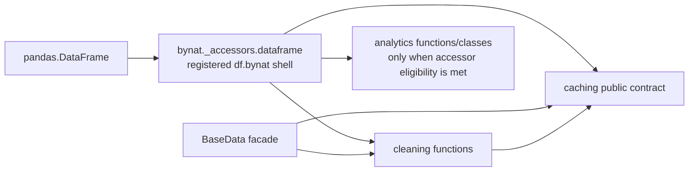

# bynat Architecture Research

**Task:** ARCH-03 / Issue #62
**Repository snapshot:** local checkout at commit `bc7fe36` (`PC-01 — Public Contract Corrections`), branch `arch-module`, package version `0.6.6`
**Research date:** 2026-11-21
**Scope:** architecture research and documentation only. No production implementation is proposed as part of this document.

> **Evidence labels used below**
>
> - **Verified fact** — directly observed in the local checkout, generated from the local source tree, or confirmed by an executed command.
> - **External evidence** — a finding supported by an explicitly linked external source.
> - **Interpretation** — an architectural conclusion drawn from the verified facts and external evidence.
> - **Recommendation** — a proposed future direction; it is not current implementation.

## Executive conclusion

`bynat` is already a small **modular monolith** using the **Functional Core + Facades** direction established by ARCH-02. Its strongest architectural property is that the reusable DataFrame operations live below two integration surfaces:

1. the supported `BaseData` / `JsonFile` / `CsvFile` class facade; and
2. the optional `df.bynat` pandas accessor facade.

The current package boundaries are mostly sound:

- `bynat.cleaning` owns DataFrame cleaning, enrichment, profiling, and I/O functions plus the supported class facade;
- `bynat.caching` owns persistent cache storage and migration independently of cleaning;
- `bynat.analytics` owns application-independent analytics and currently has no internal `bynat` dependency.

The main architectural issue is not that the repository lacks more directories. It is that `bynat/cleaning/accessor.py` is a library-wide integration boundary located inside one functional package, while it delegates across cleaning and caching and is the likely future home of analytics-facing methods. The recommended direction is a thin `bynat/_accessors/` integration package, introduced only after compatibility tests and import behavior are explicitly settled. The accessor must remain a facade; algorithms stay in their functional modules.

A second issue is an explicit requirement conflict: the ARCH-03 task text says `bynat.__init__` must remain empty, while the current checkout deliberately imports five public names and registers `df.bynat` from `bynat/__init__.py`. Existing tests and current documentation pin the non-empty behavior. This report does **not** silently resolve that conflict. Until the project approves a breaking import decision, the current tested public contract should be preserved.

The evidence does **not** justify:

- making `analytics` depend on `cleaning`;
- moving caching under cleaning;
- adding a generic `_shared` or `common` package at library level;
- splitting every large file by line count;
- replacing the class APIs with the accessor;
- adding a new service, repository, or dependency-injection layer.

## 1. Investigation scope and method

### 1.1 Local repository sources examined

The local checkout was treated as authoritative for repository facts. The investigation covered:

- complete `bynat/` package tree;
- `pyproject.toml` build metadata, dependencies, package discovery, typing, linting, and pytest configuration;
- `docs/TESTING_STANDARDS.md` as the mandatory testing constitution;
- `docs/ROADMAP.md` and the current public API policy;
- package initializers and `__all__` declarations;
- `BaseData`, `JsonFile`, `CsvFile`, `BynatAccessor`, `CacheManager`, `Analyzer`, and the shared implementation modules;
- accessor stub and documentation synchronization tooling;
- module and cross-cutting tests, especially public API, accessor parity, and analytics contract tests;
- the ARCH-02 implementation history in local Git, particularly merge commit `cca97ee`;
- the analytics integration history, particularly `721b91e`;
- current Git status and executable verification commands.

Relevant internal references:

- [`pyproject.toml`](../pyproject.toml)
- [`docs/TESTING_STANDARDS.md`](TESTING_STANDARDS.md)
- [`docs/ROADMAP.md`](ROADMAP.md)
- [`bynat/__init__.py`](../bynat/__init__.py)
- [`bynat/cleaning/base.py`](../bynat/cleaning/base.py)
- [`bynat/cleaning/accessor.py`](../bynat/cleaning/accessor.py)
- [`bynat/cleaning/accessor.pyi`](../bynat/cleaning/accessor.pyi)
- [`bynat/cleaning/_common.py`](../bynat/cleaning/_common.py)
- [`bynat/cleaning/_outputs.py`](../bynat/cleaning/_outputs.py)
- [`bynat/caching/manager.py`](../bynat/caching/manager.py)
- [`bynat/caching/_storage.py`](../bynat/caching/_storage.py)
- [`bynat/caching/_migration.py`](../bynat/caching/_migration.py)
- [`bynat/analytics/analyzer.py`](../bynat/analytics/analyzer.py)
- [`tools/sync_docs.py`](../tools/sync_docs.py)
- [`tests/cross_cutting/accessor/test_accessor.py`](../tests/cross_cutting/accessor/test_accessor.py)
- [`tests/cross_cutting/contracts/test_doc_drift.py`](../tests/cross_cutting/contracts/test_doc_drift.py)
- [`tests/modules/analytics/test_analytics_contract.py`](../tests/modules/analytics/test_analytics_contract.py)

### 1.2 LOC methodology

The measurements in this report were generated programmatically with Python's `ast` module over every tracked `*.py` file below `bynat/`, excluding `__pycache__` directories.

For each file:

- **Total LOC** is the number of physical lines in the file.
- **Blank** counts empty or whitespace-only lines.
- **Comment** counts non-empty lines whose first non-whitespace character is `#`.
- **Docstring LOC** counts the physical span of module, class, and function docstring nodes identified by the AST. Nested docstrings are counted once by their own node spans.
- **Non-docstring code LOC** counts non-blank, non-comment physical lines not belonging to one of those docstring spans.

This is a consistent comparative measure, not a claim about executable statement count, complexity, or quality. Docstring-heavy facade modules can have a large physical size without having a large algorithmic core.

## 2. Current architecture

### 2.1 Package structure observed in the checkout

```text
bynat/
├── __init__.py                         # root exports and accessor registration import
├── analytics/
│   ├── __init__.py                     # Analyzer export
│   └── analyzer.py                     # application-independent analytics class
├── caching/
│   ├── __init__.py                     # cache public exports
│   ├── _keys.py                        # key normalization and lookup helpers
│   ├── _migration.py                   # legacy JSON migration/quarantine
│   ├── _storage.py                     # SQLite connection/storage boundary
│   └── manager.py                      # CacheManager and shared manager registry
└── cleaning/
    ├── __init__.py                     # BaseData/CsvFile/JsonFile exports
    ├── _common.py                      # cleaning-scoped shared semantics
    ├── _outputs.py                     # output-type and subclass preservation helpers
    ├── accessor.py                     # registered DataFrame integration facade
    ├── accessor.pyi                    # generated accessor typing surface
    ├── base.py                         # BaseData/CsvFile/JsonFile facade
    ├── columns.py                      # column and reshape operations
    ├── io.py                           # loaders and writers
    ├── profile.py                      # profiling reports and computations
    ├── stats.py                        # imputation/outlier/statistics operations
    ├── text.py                         # text and categorization operations
    └── enrich/
        ├── __init__.py                 # provider exports
        ├── currency.py                 # currency conversion
        ├── engine.py                   # shared cached lookup engine
        ├── geocode.py                  # geocoding
        ├── nlp.py                      # spaCy entity extraction
        ├── providers.py                 # provider protocols and adapters
        └── translate.py                # translation operations
```

### 2.2 Functional Core + Facades already present

**Verified fact.** The shared functions in `columns.py`, `text.py`, `stats.py`, `profile.py`, `io.py`, and `enrich/` accept a DataFrame and implement the actual operations. `BaseData` delegates to these modules; it does not duplicate the main algorithms. For example, `BaseData.fill_missing`, `BaseData.fill_missing_from`, `BaseData.handle_outliers`, and `BaseData.get_hierarchical_stats` call the corresponding functions in `cleaning.stats` and finish the result through `_finish` or `_finish_with_stats`.

**Verified fact.** `BynatAccessor` uses `_frame_method` and `_cached_frame_method` to adapt shared functions to `df.bynat`. The factories remove the frame and internal `cache_manager` parameters from the public signature, preserve docstrings through `functools.wraps`, and implement the accessor-specific in-place mutation contract.

**Interpretation.** This is a concrete Functional Core + Imperative Shell pattern:

- the transformation functions are the computational core;
- `BaseData` is an object-oriented facade that preserves subclass and cache metadata;
- `BynatAccessor` is a pandas integration facade that registers a namespace and translates calls;
- provider adapters and `CacheManager` are imperative boundaries for external services and persistence.

The pattern is not purely functional: the cache and I/O operations necessarily perform effects. The useful architectural distinction is that effects and facade mechanics are kept at the boundary instead of being spread through every transformation.

### 2.3 Public package boundaries

Current initializer behavior is intentionally narrow:

| Package | Current public exports | Evidence |
|---|---|---|
| `bynat` | `BynatAccessor`, `ProfileReport`, `profile`, `read_csv`, `read_json` | `bynat/__init__.py`, accessor/API tests |
| `bynat.cleaning` | `BaseData`, `CsvFile`, `JsonFile` | `cleaning/__init__.py`, `test_doc_drift.py` |
| `bynat.caching` | `CacheManager`, `CACHE_DIR_ENV_VAR`, `DEFAULT_CACHE_DIR`, `shared_cache_manager` | `caching/__init__.py`, API contract tests |
| `bynat.analytics` | `Analyzer` | `analytics/__init__.py`, analytics contract tests |
| `bynat.cleaning.enrich` | provider protocols and concrete providers | `enrich/__init__.py` |

The package does not broadly re-export every transformation function. That is a deliberate boundary: callers can use the documented class/accessor APIs while implementation modules remain importable through explicit paths when needed.

### 2.4 Protected requirement conflict: root initializer

The ARCH-03 task text lists `bynat.__init__` as a protected requirement that “must remain empty.” The current local checkout does not satisfy that statement:

```python
from bynat.cleaning.accessor import BynatAccessor
from bynat.cleaning.io import read_csv, read_json
from bynat.cleaning.profile import ProfileReport, profile
```

It also declares the five-name `__all__` listed above. The current tests explicitly assert root-level imports and that importing `bynat` registers `df.bynat` (`tests/cross_cutting/accessor/test_accessor.py`). The current roadmap and repository skill likewise describe these exports as established public behavior.

**Recommendation.** Treat this as a decision-blocking compatibility conflict, not as a documentation detail. Do not make `__init__.py` empty during an architecture implementation unless the project first approves:

1. whether `import bynat` should still register the accessor;
2. whether root-level `read_csv`, `read_json`, `profile`, `ProfileReport`, and `BynatAccessor` remain supported;
3. how callers explicitly opt into accessor registration if the root import becomes inert; and
4. how the public API tests and documentation change.

Until that decision is made, preserve the current tested contract.

## 3. Quantified module assessment

### 3.1 Ranked module measurements

The following are the largest current modules by physical LOC. The table includes the complete package totals below the ranked portion.

| Rank | Module | Total | Code | Blank | Comment | Docstring | Assessment |
|---:|---|---:|---:|---:|---:|---:|---|
| 1 | `cleaning/base.py` | 2,225 | 484 | 302 | 10 | 1,638 | Large facade with extensive synchronized API documentation; not algorithmically equivalent to 2,225 lines of implementation. |
| 2 | `cleaning/profile.py` | 1,056 | 480 | 160 | 5 | 483 | Cohesive profiling pipeline plus report data classes; substantial but internally organized by column-kind computations and report models. |
| 3 | `cleaning/stats.py` | 1,054 | 593 | 131 | 4 | 356 | Largest algorithmic cleaning module; contains related hierarchical statistics, imputation, and outlier operations, with a clear shared hierarchy concept. |
| 4 | `analytics/analyzer.py` | 737 | 335 | 148 | 0 | 292 | One public `Analyzer` class with repeated response-building workflows; independent domain, no internal bynat imports. |
| 5 | `cleaning/columns.py` | 706 | 244 | 160 | 5 | 352 | Related column/reshape operations; `melt_transform_pivot` and `split_list_objects` are larger individual operations. |
| 6 | `cleaning/text.py` | 523 | 228 | 128 | 1 | 187 | Three related text features and their matching helpers. |
| 7 | `caching/manager.py` | 460 | 174 | 102 | 1 | 220 | Public cache facade over storage and migration; size is partly documentation and compatibility behavior. |
| 8 | `cleaning/enrich/translate.py` | 459 | 216 | 93 | 0 | 174 | Translation-specific operations over the shared enrichment engine. |
| 9 | `cleaning/enrich/nlp.py` | 406 | 225 | 95 | 0 | 95 | NLP configuration, lexicon extraction, and cache-key policy. |
| 10 | `cleaning/io.py` | 395 | 168 | 93 | 3 | 153 | Loaders and writers; the SQL writer is a distinct optional integration boundary. |
| 11 | `cleaning/accessor.py` | 336 | 161 | 56 | 6 | 133 | Cross-domain integration facade and registration code, not a cleaning algorithm module. |
| 12 | `cleaning/enrich/providers.py` | 259 | 70 | 59 | 0 | 155 | Protocol and adapter declarations; documentation-heavy by design. |
| 13 | `caching/_storage.py` | 256 | 129 | 39 | 0 | 107 | SQLite persistence boundary. |
| 14 | `caching/_migration.py` | 232 | 158 | 28 | 2 | 51 | Legacy migration and quarantine behavior. |
| 15 | `cleaning/enrich/engine.py` | 231 | 128 | 52 | 1 | 57 | Reusable cached-lookup algorithm shared by enrichment features. |

Complete package totals from the same measurement:

| Metric | Total |
|---|---:|
| Physical file LOC | 10,171 |
| Non-docstring code LOC | 4,181 |
| Blank lines | 1,847 |
| Comment-only lines | 46 |
| Module/class/function docstring LOC | 4,740 |

### 3.2 What the measurements do and do not show

**Verified fact.** `BaseData` is the largest file by a wide margin, but 1,638 of its 2,225 physical lines are docstrings. It contains 34 class methods, most of which are wrappers over shared functions. Splitting it solely to lower its physical LOC would risk breaking generated documentation, method ordering, subclass behavior, and public compatibility without improving responsibility ownership.

**Verified fact.** `stats.py` and `profile.py` each contain a coherent group of related operations. `stats.py` shares a hierarchy/statistics model across imputation, outlier handling, and statistics reporting. `profile.py` computes column-kind statistics and assembles report data structures.

**Recommendation.** Use responsibility, dependency direction, change locality, and test ownership as split criteria. Treat LOC as a review signal only. A module should be split when a stable boundary exists, not because a threshold is exceeded.

## 4. Responsibility and cohesion assessment

### 4.1 `cleaning/base.py`: facade and compatibility boundary

**Verified responsibilities:**

- preserve `pandas.DataFrame` subclass semantics through `_constructor` and `_metadata`;
- construct and retain the `CacheManager` used by cached operations;
- expose the supported class-based API;
- delegate transformations to functional implementations;
- implement the `inplace` and hierarchical-statistics return contracts;
- load file-backed subclasses through `io.read_json` and `io.read_csv`;
- retain synchronized docstrings for the class API.

**Cohesion judgment:** The class, its file-loading subclasses, and its wrapper methods are cohesive as a compatibility facade. The file is large because it is a public API surface with extensive documentation, not because unrelated algorithms were combined in one implementation module.

**Potential future separation:** A generated binding table or smaller facade modules could reduce maintenance cost, but only after signature/docstring synchronization and subclass behavior are protected by contract tests. This is optional, not an immediate architecture defect.

### 4.2 `cleaning/accessor.py`: integration facade

**Verified responsibilities:**

- register the `bynat` DataFrame accessor;
- store the wrapped DataFrame by reference;
- resolve or accept a `CacheManager`;
- generate accessor-facing signatures;
- adapt shared functions to accessor methods;
- remove internal `cache_manager` parameters from public signatures;
- perform in-place mutation only when requested;
- delegate to columns, text, stats, profile, I/O, and enrichment modules.

**Cohesion judgment:** The wrapper factories and registration code are cohesive as an integration mechanism. The location under `cleaning` is understandable historically, but its consumers and responsibilities are broader than cleaning. It is the strongest candidate for a future library-level `_accessors/` boundary.

### 4.3 `cleaning/stats.py`: hierarchy-based statistics domain

The module contains the shared `_hierarchical_outlier_masks` algorithm and operations that use the same hierarchy relaxation semantics:

- `handle_outliers`;
- `drop_outliers`;
- `fill_missing`;
- `fill_missing_from`;
- `get_hierarchical_stats`.

These operations are related by actual implementation concepts: hierarchy normalization, group thresholds, progressively coarser levels, global fallback, and statistics output. Splitting them merely into “outliers,” “imputation,” and “stats” modules would duplicate the hierarchy contract or create an artificial internal layer. A future split would be justified only if one responsibility develops independent dependencies or a separate public lifecycle.

### 4.4 `cleaning/profile.py`: profiling domain

`profile.py` contains the column-kind dispatch and report models (`DatasetProfile`, `ColumnProfile`, `ProfileReport`) used by the public `profile` function. It is conceptually adjacent to cleaning because it examines DataFrames, but it is not an automatic transformation. The current placement under `cleaning` is compatible with the existing public API and does not create an observed dependency from analytics to cleaning.

A future quality/inspection package could be considered if validation and profiling grow into a distinct domain. That is not justified by the current code alone.

### 4.5 `cleaning/columns.py`, `text.py`, and `io.py`

- `columns.py` groups structural column and reshape transformations. The operations share DataFrame transformation semantics and cleaning-scoped helpers.
- `text.py` groups keyword extraction, substring truncation, and reference categorization. They share text-oriented input/output behavior and optional Aho-Corasick integration.
- `io.py` groups JSON/CSV loading and JSON/SQL writing. The functions have a common boundary responsibility—converting between DataFrames and external representations—but the SQL path is an optional external integration.

The current modules should remain standalone unless independent growth creates a real subpackage boundary. A directory for every function would be fragmentation, not modularity.

### 4.6 `cleaning/enrich/`

The enrichment package has a genuine functional grouping:

- feature modules: `translate.py`, `geocode.py`, `currency.py`, `nlp.py`;
- shared algorithm: `engine.py`;
- provider protocols/adapters: `providers.py`.

`engine.py` is shared because it implements one actual cached-lookup algorithm used by several enrichment methods. `providers.py` is shared because the protocol and adapter types are part of the integration boundary for those features. This is evidence-based sharing, not a generic utility bucket.

### 4.7 `caching/`

`CacheManager` is the public cache facade. `_storage.py` owns SQLite details, `_migration.py` owns legacy JSON migration/quarantine, and `_keys.py` owns key normalization. The dependency direction is downward:

```text
CacheManager (public facade)
├── legacy migration/quarantine
└── SQLite storage
    └── cache-key/value serialization helpers where needed
```

Caching is consumed by enrichment and facades, but caching does not import cleaning. Moving it inside `cleaning` would invert the current dependency direction and make a reusable persistence component depend on one consumer domain.

### 4.8 `analytics/analyzer.py`

`Analyzer` accepts a DataFrame, defensively copies it, and returns JSON-serializable response dictionaries for distributions, aggregations, time series, KPI values, and bins. It implements its own filters and computed rules and has no internal `bynat` imports.

This independence is architecturally valuable. The presence of a DataFrame parameter does not make analytics a cleaning submodule. Its contract is analytical response generation, not data preparation. Analytics may consume a DataFrame produced by cleaning at the application composition level without importing cleaning implementation code.

## 5. Dependency analysis

### 5.1 Direct internal dependency map

The following map is derived from imports in the local source tree and reduced to package-level relationships. It distinguishes actual imports from conceptual usage.

```mermaid
flowchart TD
    Root["bynat root exports / registration"] --> Accessor["cleaning.accessor"]
    Root --> IO["cleaning.io"]
    Root --> Profile["cleaning.profile"]

    Accessor --> CleaningFns["cleaning functional modules"]
    Accessor --> Cache["caching public API"]
    Base["cleaning.base / BaseData"] --> CleaningFns
    Base --> Cache
    Base --> Providers["enrich.providers"]

    Columns["cleaning.columns"] --> Common["cleaning._common"]
    Text["cleaning.text"] --> Common
    IO --> Common
    Stats["cleaning.stats"] --> Common
    Stats --> Outputs["cleaning._outputs"]
    Profile --> Common
    Profile --> Outputs

    Enrich["cleaning.enrich feature modules"] --> Engine["enrich.engine"]
    Enrich --> Providers
    Enrich --> Common
    Engine --> Cache
    Engine --> CacheKeys["caching._keys"]
    Engine --> Common

    Manager["caching.manager"] --> Storage["caching._storage"]
    Manager --> Migration["caching._migration"]
    Migration --> Storage

    Analytics["analytics.analyzer"]

    classDef facade fill:#e7f0ff,stroke:#356ae6;
    classDef domain fill:#eef8ee,stroke:#3a8f3a;
    classDef infra fill:#fff4df,stroke:#b06b00;
    class Accessor,Base,Root facade;
    class CleaningFns,Columns,Text,IO,Stats,Profile,Enrich,Engine,Providers,Analytics domain;
    class Cache,CacheKeys,Manager,Storage,Migration,Common,Outputs infra;
```



### 5.2 Cross-subpackage relationships

| Relationship | Verified status | Architectural meaning |
|---|---|---|
| `cleaning` → `caching` | Actual imports from `base.py`, `accessor.py`, and enrichment modules | Cleaning operations use caching for external lookup reuse; this is a consumer dependency. |
| `caching` → `cleaning` | No direct internal import found | Caching remains reusable infrastructure and does not know its consumers. |
| `analytics` → `cleaning` | No direct internal import found | Analytics can receive cleaned data without package coupling. |
| `analytics` → `caching` | No direct internal import found | Analytics has no cache ownership requirement in the current implementation. |
| `accessor` → cleaning and caching | Actual imports | Accessor is an integration surface, not a functional owner. |
| `BaseData` → cleaning and caching | Actual imports | Class API is a compatibility facade over functional operations and cache metadata. |
| `enrich.engine` → caching | Actual imports | The shared lookup engine persists results through the cache contract. |

### 5.3 Cycles and dependency risks

**Verified fact.** No internal cycle was found in the direct package import graph. The current graph is substantially acyclic: facades depend on implementation modules; implementation modules depend on scoped helpers and infrastructure; analytics is isolated.

**Risk.** `cleaning.accessor` currently imports a wide set of cleaning modules and caching. As more functional packages are added, continuing to add methods to this module can turn it into a high-churn integration hub. That is a change-locality and ownership risk, not a current circular dependency.

**Risk.** `cleaning._common` contains several unrelated-but-cleaning-scoped semantics: optional imports, validation, merge alignment, deduplication, logger ownership, and DataFrame subclass preservation. It is not yet evidence for a library-level common package. If its responsibilities diverge, the correct response is to move a responsibility to the owning domain, not to enlarge a generic `_shared` package.

## 6. Joint evaluation of `cleaning`, `caching`, and `analytics`

### 6.1 Recommended relationship

```text
Application composition
        │
        ├── cleaning functions / BaseData / df.bynat
        ├── analytics.Analyzer
        └── optional persistence and providers

cleaning ───────► caching
analytics ──────► (no required package dependency)
accessor ───────► cleaning, analytics (only if an eligible analytics method is added), caching
caching ────────► no cleaning or analytics dependency
```

This is a peer-package modular monolith, not a linear “cleaning → analytics” pipeline encoded in imports.

### 6.2 Why analytics should not depend on cleaning by default

`Analyzer` already accepts any `pandas.DataFrame`, copies it, and computes outputs without importing cleaning. Making analytics import cleaning merely because users often clean data before analyzing it would turn an application workflow into a package dependency. It would also make analytics harder to reuse with DataFrames produced by pandas, Polars conversion, SQL reads, or another library.

A caller may compose the packages:

```python
cleaned = df.bynat.fill_missing("amount", strategy="median")
result = Analyzer(cleaned).get_kpi_value("amount", agg_func="sum")
```

The composition belongs in the caller or a future explicit workflow API, not in an import from `bynat.analytics` to `bynat.cleaning`.

### 6.3 Why caching should remain a peer package

Caching has a stable infrastructure contract (`CacheManager`, cache directory resolution, SQLite storage, legacy migration) and is useful to enrichment without being a cleaning concept. The current dependency direction is correct: consumers use the cache, while the cache does not import consumers.

A future analytics cache could use `CacheManager` through the public caching API if a real requirement appears. That would still be `analytics → caching`, not `caching → analytics` and not “caching inside cleaning.” No such analytics cache requirement is present today.

### 6.4 How future functional packages should be introduced

Add a new top-level functional package when all of the following are true:

1. it has a coherent domain contract independent of existing package internals;
2. it has multiple operations or a lifecycle that would otherwise overload an existing module;
3. its public API and dependencies can be named without importing a facade;
4. the package can be tested and documented as an owner; and
5. the new boundary reduces coupling rather than merely adding a directory.

A single new function should normally remain in the closest cohesive module. A package should not be created solely to reserve a future name.

## 7. Shared component ownership

| Component | Current location | Consumers / role | Ownership decision |
|---|---|---|---|
| `import_optional`, `require_positive_int`, `left_merge_aligned`, `dedupe_key`, `like` | `cleaning/_common.py` | Multiple cleaning modules; optional imports, DataFrame alignment, validation, value normalization, subclass preservation | Keep cleaning-scoped for now. These functions share cleaning transformation semantics. Do not promote them to library-level `_shared` merely because several cleaning modules use them. Re-evaluate individual functions if a non-cleaning package gains a real dependency. |
| Output-type conversion helpers | `cleaning/_outputs.py` | `stats.py`, `profile.py`, and output handling; recognizes `BaseData` without importing the facade | Keep under cleaning. The module deliberately avoids a lower-level-to-facade import and protects the functional core from `BaseData` coupling. |
| `_cached_map` and related lookup helpers | `cleaning/enrich/engine.py` | translation, geocoding, currency, NLP | Keep in `enrich`. This is genuinely shared enrichment behavior with shared cache semantics, not generic caching infrastructure. |
| Provider protocols and adapters | `cleaning/enrich/providers.py` | translation, geocoding, currency; facade type signatures | Keep in `enrich`. Provider contracts are feature-boundary types, not library-wide service abstractions. |
| Cache key normalization | `caching/_keys.py` | cache manager and enrichment engine | Keep in `caching`; the key contract belongs to persistent cache identity. Enrichment should use the public cache contract where possible and should not own storage identity rules. |
| SQLite storage and legacy migration | `caching/_storage.py`, `caching/_migration.py` | `CacheManager` | Keep private to caching. Their consumers should not import them directly. |
| `Analyzer` filter/rule helpers | `analytics/analyzer.py` | Analyzer methods only | Keep class-local until a second independent analytics component demonstrates stable shared ownership. |
| Accessor wrapper factories | `cleaning/accessor.py` today | all `df.bynat` methods | Move conceptually to a future `_accessors/` integration owner; do not move during this report. The factories are integration mechanics rather than cleaning algorithms. |

**Ownership rule.** Consumer count is evidence of reuse, not proof of ownership. A shared component belongs where its invariants, dependencies, and change reasons are owned. The current repository already demonstrates this distinction: `_cached_map` is shared within enrichment, while SQLite storage is shared within caching, and analytics remains independent.

## 8. DataFrame accessor architecture

### 8.1 External evidence

The pandas extension guide describes custom accessors as namespaces attached to pandas objects, registered with decorators, and initialized with the object they wrap. It recommends validation in the accessor initializer and presents accessors as an extension mechanism that does not require subclassing:

- [pandas extending guide — Registering custom accessors](https://pandas.pydata.org/docs/development/extending.html)
- [`register_dataframe_accessor`](https://pandas.pydata.org/docs/reference/api/pandas.api.extensions.register_dataframe_accessor.html)

This directly supports `df.bynat` as an optional integration surface while preserving `BaseData` independently.

### 8.2 Current accessor behavior

**Verified facts from `cleaning/accessor.py`:**

- `@pd.api.extensions.register_dataframe_accessor("bynat")` performs registration;
- the accessor wraps a DataFrame by reference;
- `with_cache(...)` binds an explicit or shared `CacheManager`;
- wrapper factories derive public signatures from shared function signatures;
- `cache_manager` is injected internally and omitted from the accessor-facing signature;
- `inplace=True` calls `_update_inplace` on the wrapped object;
- methods delegate to functional implementations in cleaning and enrichment;
- `accessor.pyi` is generated by `tools/sync_docs.py`;
- `test_doc_drift.py` verifies runtime signatures, docstrings, and the generated stub.

The accessor therefore already has a clear integration responsibility. It must not absorb the algorithms it delegates to.

### 8.3 Proposed organizational direction: `bynat/_accessors/`

**Recommendation.** Organize future library-level pandas integrations under a private package such as:

```text
bynat/
└── _accessors/
    ├── __init__.py              # registration policy, if needed
    ├── dataframe.py             # DataFrame accessor registration and shell
    ├── _binding.py              # signature/docstring/cache binding helpers
    └── _compat.py               # only if a verified compatibility seam exists
```

This is a target direction, not a change made by ARCH-03. The current `cleaning/accessor.py` remains the implementation until a separate migration is approved.

The package exists because the accessor integrates multiple functional domains and pandas registration. It does **not** own:

- cleaning algorithms;
- analytics algorithms;
- cache storage;
- provider implementations;
- public class compatibility behavior.

A future accessor can delegate as follows:



### 8.4 Accessor eligibility criteria

A function belongs in `df.bynat` only when all of these are satisfied:

1. **DataFrame receiver fit:** the operation naturally reads or transforms the receiver DataFrame rather than primarily operating on a cache, provider, report object, or external file.
2. **Stable user workflow:** the operation is useful as a fluent DataFrame operation and is likely to be called repeatedly in DataFrame pipelines.
3. **Clear receiver contract:** input mutation, returned object type, index behavior, column behavior, and exceptions can be stated as a DataFrame method contract.
4. **Facade independence:** the method can delegate to a functional implementation without moving algorithmic ownership into the accessor.
5. **Optional integration value:** exposing the operation on a DataFrame improves discoverability or parity with `BaseData`; it is not added merely because it accepts a DataFrame.
6. **Public API cost is justified:** the name, signature, docstring, stub, tests, and long-term compatibility burden are acceptable.
7. **No hidden external boundary:** operations whose main purpose is cache management, provider construction, or file/database configuration should remain explicit APIs rather than accessor methods.

Examples:

- `rename_all_DOTS`, `fill_missing`, and `extract_keywords` meet the receiver and transformation criteria.
- `CacheManager` construction does not become an accessor method; `with_cache(...)` is an integration convenience because it selects the cache used by receiver operations.
- `Analyzer` itself should not automatically become `df.bynat.analyzer(...)`. Its response-oriented API and defensive-copy model are a separate public abstraction. An accessor analytics method would require a concrete, stable DataFrame contract and should be justified by use cases.
- `save_to_sql` may be exposed as a receiver operation because the DataFrame is the thing being written, but its database configuration remains an I/O boundary and must not be hidden in an algorithm module.

### 8.5 Registration and imports

Pandas registration is an import-time side effect. The current repository registers the accessor as a consequence of importing `bynat` because `bynat/__init__.py` imports `cleaning.accessor`.

A future `_accessors/` package must make one explicit choice:

- **Current compatibility mode:** importing `bynat` continues to import the registration module and `df.bynat` is available immediately.
- **Explicit optional mode:** the root package remains inert and callers import a documented registration module before using `df.bynat`.

These modes are not interchangeable. The second mode conflicts with the current tests and user-facing behavior. The root-initializer conflict in §2.4 must be resolved before changing registration.

PyPA's plugin-discovery guidance is relevant by analogy: package import paths and registration mechanisms should be deliberate, and a package should not be made a namespace merely to solve a plugin-like discovery problem. See [Creating and discovering plugins](https://packaging.python.org/en/latest/guides/creating-and-discovering-plugins/).

## 9. Comparison of architectural approaches

| Approach | Evidence-based fit for current `bynat` | Benefits | Costs / rejection reason | Decision |
|---|---|---|---|---|
| Functional Core + Imperative Shell / Facades | Strong fit; already present in shared functions, `BaseData`, accessor, providers, and cache boundaries | Keeps algorithms reusable; supports class/accessor parity; isolates persistence and external effects | Requires disciplined contracts and generated-doc synchronization | **Retain and refine** |
| Modular monolith | Strong fit for current size and packaging; `cleaning`, `caching`, and `analytics` are independently meaningful packages in one distribution | Stable internal boundaries without deployment/distribution overhead; supports incremental growth | Requires import discipline and explicit public exports | **Recommended container architecture** |
| Layered architecture | Useful as a dependency rule, not as the primary directory layout | Clarifies facade → domain → infrastructure flow | A global presentation/domain/data tree would hide domain ownership and make `cleaning`, `caching`, and `analytics` cross-cut each other | **Use selectively as a dependency constraint** |
| Domain-oriented packages | Good fit for current peer packages and enrichment subpackage | Aligns ownership with actual contracts; keeps analytics independent and caching reusable | Requires resisting overly fine-grained domain splitting | **Use at package level** |
| Feature-oriented structure | Partial fit inside enrichment, where translation/geocode/currency/NLP are feature groups | Localizes feature-specific code and tests | A top-level feature tree would duplicate shared DataFrame and cache contracts and weaken current public package boundaries | **Use within genuine feature groups only** |
| Composition-based module design | Good fit for provider protocols, wrapper factories, shared lookup engine, and `Analyzer` helper workflow | Reuses behavior through composition rather than inheritance; supports adapters | More abstractions increase surface area if introduced without a second consumer or concrete seam | **Use where already evidenced; do not expand speculatively** |

### 9.1 External comparisons

- The [Python modules documentation](https://docs.python.org/3/tutorial/modules.html) describes regular packages, package initializers, and controlled exports through `__all__`. This supports deliberate package boundaries rather than indiscriminate root re-exports.
- The [Python import system reference](https://docs.python.org/3/reference/import.html) explains fully qualified module names, parent package loading, and import registration. This matters because accessor registration is import-time behavior.
- The [PyPA `pyproject.toml` specification](https://packaging.python.org/en/latest/specifications/pyproject-toml/) supports keeping build metadata, dependencies, and tool configuration explicit in the project configuration. It does not justify adding a new runtime layer.
- The [scikit-learn developer guide](https://scikit-learn.org/stable/developers/develop.html) distinguishes public API from private implementation, emphasizes compositional estimators/mixins, and documents a package structure with deliberate public interfaces. Its source also demonstrates explicit top-level aggregation in [`sklearn/__init__.py`](https://github.com/scikit-learn/scikit-learn/blob/main/sklearn/__init__.py) and reusable contracts in [`sklearn/base.py`](https://github.com/scikit-learn/scikit-learn/blob/main/sklearn/base.py).
- pandas itself uses a deliberate public aggregation boundary in [`pandas/__init__.py`](https://github.com/pandas-dev/pandas/blob/main/pandas/__init__.py), while its extension guide places custom behavior behind registered accessor namespaces.
- Polars documents an eager/lazy distinction and expression composition in its [lazy API guide](https://docs.pola.rs/user-guide/concepts/lazy-api/). Its large DataFrame surface in [`frame.py`](https://github.com/pola-rs/polars/blob/main/py-polars/src/polars/dataframe/frame.py) is a useful warning against using physical file size as the sole architectural measure. The current `bynat` requirements do not justify adding a lazy execution layer.
- The [Functional Core, Imperative Shell](https://www.destroyallsoftware.com/screencasts/catalog/functional-core-imperative-shell) description supports separating value computation from I/O and integration effects.
- Fowler's [Monolith First](https://martinfowler.com/bliki/MonolithFirst.html), [Presentation-Domain-Data Layering](https://martinfowler.com/bliki/PresentationDomainDataLayering.html), and [Software Component](https://martinfowler.com/bliki/SoftwareComponent.html) support treating modules as logical boundaries and avoiding premature deployment or service decomposition.

## 10. Candidate and recommended package hierarchies

### 10.1 Candidate A: retain current hierarchy with discipline

```text
bynat/
├── analytics/
├── caching/
└── cleaning/
    ├── accessor.py
    ├── base.py
    ├── columns.py
    ├── enrich/
    ├── io.py
    ├── profile.py
    ├── stats.py
    └── text.py
```

**Strengths:** no migration risk; matches current imports and tests.
**Weakness:** the library-wide accessor remains located under cleaning.

### 10.2 Candidate B: move the accessor integration boundary

```text
bynat/
├── _accessors/
│   ├── __init__.py
│   ├── _binding.py
│   └── dataframe.py
├── analytics/
├── caching/
└── cleaning/
    ├── base.py
    ├── columns.py
    ├── enrich/
    ├── io.py
    ├── profile.py
    ├── stats.py
    └── text.py
```

**Strengths:** ownership matches the accessor's cross-domain role; future analytics integration has a natural home; functional packages remain peers.
**Risks:** import-time registration, generated stub paths, old explicit imports, and root API behavior must be migrated and tested together.

### 10.3 Candidate C: global layers

```text
bynat/
├── api/
├── domain/
├── infrastructure/
└── integrations/
```

**Assessment:** rejected as the primary hierarchy. It would put cleaning, analytics, and caching concepts into global layers and obscure which package owns a behavior. A limited layer rule remains useful inside Candidate B: facades/integrations may depend on functional implementations and infrastructure contracts, while infrastructure must not import facades.

### 10.4 Recommendation

Adopt **Candidate A immediately as the compatibility baseline**, with **Candidate B as the target direction for a separately planned migration**. The architecture is therefore a hybrid:

- modular monolith at package level;
- domain-oriented packages (`cleaning`, `caching`, `analytics`);
- functional core plus class/accessor facades;
- selective feature-oriented grouping inside `cleaning/enrich`;
- composition for provider adapters, cache lookup, and facade binding;
- a layered dependency rule, not a layer-first directory tree.

### 10.5 Package ownership rules for the recommended hierarchy

| Package | Owns | Must not own |
|---|---|---|
| `bynat.cleaning` | DataFrame cleaning, enrichment, profiling, and I/O functional implementations; supported class facade | Library-wide accessor registration mechanics; cache storage internals |
| `bynat.caching` | Cache directory resolution, public manager, SQLite persistence, migration, key identity | Cleaning or analytics algorithms |
| `bynat.analytics` | Application-independent analytics and response contracts | Cleaning imports merely because inputs are DataFrames; cache storage without a concrete requirement |
| `bynat._accessors` (target) | pandas registration, wrapper binding, accessor signatures, accessor-specific mutation adaptation | Underlying algorithms, provider implementations, SQLite details |
| `cleaning._common` / scoped internals | Helpers whose invariants are owned by cleaning | Generic catch-all utilities used to avoid deciding ownership |

### 10.6 When a module should remain standalone

Keep a module standalone when:

- it owns one cohesive public or internal contract;
- its consumers are within one domain;
- splitting would create circular imports or duplicate protocol definitions;
- the module's size is mostly documentation or generated compatibility surface; or
- no independent release, test, or dependency boundary exists.

Create a subpackage when multiple modules share a named domain, have distinct responsibilities, and benefit from a package-level initializer and ownership boundary. `cleaning/enrich` and `caching` meet this standard; a one-function future helper does not.

## 11. Prioritized refactoring opportunities

These are recommendations for future work. None is implemented by ARCH-03.

### P1 — Resolve the root initializer and accessor-registration contract

- **Current location:** `bynat/__init__.py`, `tests/cross_cutting/accessor/test_accessor.py`, `docs/ROADMAP.md`.
- **Current responsibility:** root-level public exports and import-time accessor registration.
- **Issue:** task requirements say the initializer must be empty, while the current public API and tests require five root exports and automatic registration.
- **Dependencies and consumers:** all documented root imports, accessor registration, API contract tests, packaging/import behavior.
- **Proposed organization:** approve one explicit compatibility decision before moving code. If inert-root behavior is selected, put registration behind an explicit import and revise tests/docs. If current behavior is retained, update the conflicting requirement and preserve the narrow root exports.
- **Supporting evidence:** current initializer content; accessor registration decorator; public API tests; Python import semantics.
- **Benefits:** removes ambiguity before any accessor migration.
- **Risks:** possible breaking import behavior and user migration.
- **Priority:** P1.
- **Dependencies on other work:** project-level API decision and updated acceptance criteria.

### P1 — Establish `bynat/_accessors/` as the future integration owner

- **Current location:** `bynat/cleaning/accessor.py`.
- **Current responsibility:** registration, binding, signatures, cache injection, and every accessor method.
- **Issue:** a library-wide integration boundary is housed under one functional domain and will become a high-churn hub if analytics or future packages add methods.
- **Dependencies and consumers:** `bynat/__init__.py`, `BaseData` parity tests, generated `accessor.pyi`, `tools/sync_docs.py`, all accessor methods.
- **Proposed organization:** move registration and binding mechanics to a private `_accessors/` package in a separate compatibility-preserving change; keep delegated algorithms in their owning packages.
- **Supporting evidence:** `accessor.py` imports cleaning modules and caching; pandas recommends accessor namespaces; current wrapper factories already form a coherent integration mechanism.
- **Benefits:** clearer ownership, future analytics integration without placing code under cleaning, lower conceptual coupling.
- **Risks:** import-time registration, stub generation, explicit import compatibility, and root API migration.
- **Priority:** P1, after the root contract decision.
- **Dependencies on other work:** P1 root contract; migration tests; generated-stub update.

### P2 — Preserve and document the peer relationship of analytics and cleaning

- **Current location:** `bynat/analytics/analyzer.py`, `bynat/cleaning/*`, `docs/ROADMAP.md`.
- **Current responsibility:** analytics consumes any DataFrame independently; cleaning transforms DataFrames.
- **Issue:** future convenience APIs could create an accidental `analytics → cleaning` dependency.
- **Dependencies and consumers:** application callers and any future accessor analytics methods.
- **Proposed organization:** keep direct package imports absent; use caller-level composition or an explicitly designed workflow module if orchestration becomes a real product requirement.
- **Supporting evidence:** analyzer has no internal bynat imports; analytics contract tests accept ordinary DataFrames and BaseData-converted frames.
- **Benefits:** reuse, lower coupling, easier independent testing.
- **Risks:** callers must compose two APIs explicitly.
- **Priority:** P2 preventive architecture rule.
- **Dependencies on other work:** none.

### P2 — Keep caching independent and enforce its public/private boundary

- **Current location:** `bynat/caching/manager.py`, `_storage.py`, `_migration.py`, `_keys.py`.
- **Current responsibility:** public cache API over SQLite, migration, and key identity.
- **Issue:** consumers may be tempted to import storage or key internals for convenience.
- **Dependencies and consumers:** enrichment engine, `BaseData`, accessor.
- **Proposed organization:** keep public consumers on `bynat.caching`; keep storage/migration/key modules private and independently test them under caching ownership.
- **Supporting evidence:** no caching-to-cleaning import; ARCH-02 introduced the storage/migration decomposition; tests pin public exports.
- **Benefits:** replaceable persistence details and stable consumer contract.
- **Risks:** public API may need a deliberate extension when a new cache capability is truly shared.
- **Priority:** P2.
- **Dependencies on other work:** none.

### P2 — Review `cleaning._common.py` by invariant, not consumer count

- **Current location:** `bynat/cleaning/_common.py`.
- **Current responsibility:** optional imports, validation, aligned merge, dedupe normalization, logger, subclass preservation.
- **Issue:** several different helper concepts share one private module; future additions could turn it into a catch-all.
- **Dependencies and consumers:** columns, text, I/O, stats, profile, enrichment.
- **Proposed organization:** keep it temporarily; move individual helpers only when a clear owning domain or independent dependency boundary exists. Do not create `bynat._shared` by default.
- **Supporting evidence:** all current consumers are cleaning or enrichment; helpers encode cleaning-specific DataFrame contracts.
- **Benefits:** avoids premature fragmentation and generic utility coupling.
- **Risks:** continued growth could increase private-module ambiguity.
- **Priority:** P2 monitoring item.
- **Dependencies on other work:** revisit during any substantive helper change.

### P3 — Consider a generated or split facade strategy for `BaseData`

- **Current location:** `bynat/cleaning/base.py`.
- **Current responsibility:** supported DataFrame subclass, file subclasses, wrappers, metadata, and extensive synchronized docs.
- **Issue:** physical size and method count increase review cost, although the responsibility is cohesive.
- **Dependencies and consumers:** pandas subclass behavior, shared functions, `tools/sync_docs.py`, accessor parity, documented imports.
- **Proposed organization:** first improve generation/binding metadata or split only along proven facade ownership boundaries; do not split by method count alone.
- **Supporting evidence:** 1,638 docstring LOC; 34 methods are mostly wrappers; tests pin subclass and docstring behavior.
- **Benefits:** lower maintenance cost if done safely.
- **Risks:** signature drift, import changes, subclass propagation regressions.
- **Priority:** P3.
- **Dependencies on other work:** stronger generated-contract tests and a concrete maintenance pain point.

### P3 — Add analytics accessor methods only by eligibility review

- **Current location:** future integration decision; current `Analyzer` remains in `analytics/analyzer.py`.
- **Current responsibility:** response-oriented analytics class.
- **Issue:** automatic accessor exposure would broaden the public API without proving a fluent DataFrame contract.
- **Dependencies and consumers:** `_accessors/` target, analytics API, documentation, stubs, parity tests.
- **Proposed organization:** keep `Analyzer` independent; add an accessor method only for a specific operation that satisfies §8.4.
- **Supporting evidence:** current Analyzer has a defensive-copy object contract and no internal bynat imports.
- **Benefits:** avoids API inflation and preserves analytics independence.
- **Risks:** users may request convenience methods later.
- **Priority:** P3 / decision gate.
- **Dependencies on other work:** concrete use case and accessor ownership decision.

### Changes that should not be made

1. Do not move `caching` under `cleaning`.
2. Do not add a direct `analytics → cleaning` import solely because both use DataFrames.
3. Do not replace `BaseData`, `CsvFile`, or `JsonFile` with `df.bynat`.
4. Do not make every public function an accessor method.
5. Do not create a generic root `_shared` or `common` package without a domain-independent contract.
6. Do not split `base.py`, `stats.py`, or `profile.py` solely to lower LOC.
7. Do not add lazy execution, repository/service, or dependency-injection layers without a demonstrated requirement.
8. Do not broaden `__all__` to expose internal implementation details.

## 12. Architectural decision records

### ADR-01 — Adopt a hybrid modular monolith with Functional Core + Facades

- **Problem:** `bynat` has multiple public access styles and persistence/provider effects but should remain a small installable library.
- **Alternatives:** global layers; feature-only tree; microservices/plugins; current flat monolith without boundaries.
- **Evidence:** current shared functions, `BaseData`, accessor wrapper factories, separate caching package, and independent analytics package; Fowler's modular-monolith and component guidance.
- **Evaluation:** the hybrid preserves current compatibility while keeping functional operations reusable and effects at boundaries.
- **Selected approach:** retain the modular monolith and refine Functional Core + Facades.
- **Rejected alternatives:** global layers obscure domain ownership; separate deployable components are unjustified; an unstructured monolith would lose current boundaries.
- **Trade-offs:** more explicit package/import discipline and synchronized facade contracts.

### ADR-02 — Keep `cleaning`, `caching`, and `analytics` as peer packages

- **Problem:** DataFrame usage creates a temptation to make all packages depend on cleaning.
- **Alternatives:** analytics inside cleaning; caching inside cleaning; linear cleaning → analytics → caching pipeline.
- **Evidence:** analytics has no internal imports; caching has no cleaning dependency; cleaning consumes caching for enrichment.
- **Evaluation:** peer packages reflect actual ownership and permit caller-level composition.
- **Selected approach:** `cleaning → caching` where needed; `analytics` remains independent; no reverse dependency.
- **Rejected alternatives:** they encode workflow order as package coupling and reduce reuse.
- **Trade-offs:** applications must compose cleaning and analytics explicitly.

### ADR-03 — Keep shared components in their owning domain

- **Problem:** several modules reuse helpers.
- **Alternatives:** generic `_shared` package; copy helpers; move every helper to a root utility module; retain scoped owners.
- **Evidence:** `_common.py` helpers encode cleaning DataFrame semantics; `_cached_map` is enrichment-specific; cache keys are storage identity.
- **Evaluation:** invariants and dependency ownership are stronger evidence than consumer count.
- **Selected approach:** retain `cleaning._common`, `cleaning.enrich.engine`, and `caching._keys` in their current domains; move individual helpers only when evidence changes.
- **Rejected alternatives:** generic utilities create ambiguous ownership and coupling.
- **Trade-offs:** some reuse remains domain-qualified rather than globally convenient.

### ADR-04 — Place future accessor integration under `bynat/_accessors/`

- **Problem:** the current accessor is library-wide integration code located under cleaning.
- **Alternatives:** keep expanding `cleaning/accessor.py`; place accessors in each functional package; create `_accessors/`; use plugin entry points.
- **Evidence:** current accessor imports cleaning and caching, performs registration and signature binding, and is not an algorithm owner; pandas provides a direct accessor mechanism.
- **Evaluation:** a private integration package reflects responsibility without creating a new public namespace.
- **Selected approach:** target `_accessors/` as a thin integration boundary; migrate separately with compatibility tests.
- **Rejected alternatives:** continued growth under cleaning increases cross-domain coupling; per-domain registration fragments one DataFrame namespace; plugin entry points are unnecessary for the built-in accessor.
- **Trade-offs:** migration and import-time registration complexity.

### ADR-05 — Treat registration/import behavior as a public contract

- **Problem:** importing `bynat` currently registers `df.bynat`, while the task text requires an empty root initializer.
- **Alternatives:** preserve automatic registration; make registration explicit; register from a hidden side effect elsewhere; break root imports.
- **Evidence:** current `bynat/__init__.py`, pandas registration decorator, accessor tests, and Python import semantics.
- **Evaluation:** hidden side effects are less clear; explicit registration would be a breaking change; current behavior is tested.
- **Selected approach:** preserve current behavior until a formal API decision approves a change; record the conflict explicitly.
- **Rejected alternatives:** silent change would violate established tests and imports.
- **Trade-offs:** current root initializer remains non-empty despite the conflicting task statement.

### ADR-06 — Make accessor eligibility contract-based

- **Problem:** exposing every DataFrame-related function would inflate the public API.
- **Alternatives:** mirror all cleaning/analytics functions; expose only transformations; expose only high-frequency fluent operations; add methods ad hoc.
- **Evidence:** current accessor methods are DataFrame transformations and I/O operations with explicit contracts; `Analyzer` is a separate response-oriented class.
- **Evaluation:** receiver fit, stable mutation/return contract, delegation, and API value provide a repeatable gate.
- **Selected approach:** use the seven criteria in §8.4 and require tests, docs, and stub synchronization.
- **Rejected alternatives:** automatic mirroring creates long-term compatibility burden and weakens ownership.
- **Trade-offs:** some convenient operations remain explicit module/class APIs.

### ADR-07 — Preserve narrow public exports

- **Problem:** internal implementations are easier to import when re-exported broadly, but that creates compatibility commitments.
- **Alternatives:** export every function at root; export all module names; retain current narrow exports.
- **Evidence:** current `__all__` boundaries and `test_doc_drift.py`; Python package export guidance; mature packages such as pandas and scikit-learn use deliberate aggregation.
- **Evaluation:** narrow exports make public/private ownership explicit and prevent internal details from becoming accidental API.
- **Selected approach:** preserve current package-level exports and add exports only through an explicit compatibility decision.
- **Rejected alternatives:** broad exports simplify some imports at the cost of long-term API stability.
- **Trade-offs:** callers use explicit submodule paths for lower-level APIs.

## 13. Verification baseline and acceptance review

### 13.1 Executed local checks

The following commands were executed against the local checkout before this document was written:

```text
./.venv-check/Scripts/pytest.exe -q
645 passed, 29 deselected, 16 xfailed, 4 warnings in 47.40s

./.venv-check/Scripts/ruff.exe check bynat tests benchmarks
All checks passed!

./.venv-check/Scripts/mypy.exe
Success: no issues found in 120 source files
```

The four pytest warnings were upstream pandas deprecation/user warnings in the current analytics time-floor and JSON dtype-selection paths. They were not treated as architectural failures.

The initial Git status was clean on branch `arch-module`. The only intended repository modification from this task is this file.

### 13.2 ARCH-03 acceptance coverage

| Requirement | Coverage in this report |
|---|---|
| Complete local repository inspection | §§1–2, package tree, source/test/config references |
| `TESTING_STANDARDS.md` treated as mandatory | §§1, 2.3, 8, 13 |
| ARCH-02 reviewed | §§1.1, 2.2, 6, Git history references |
| TEST-01 / issue #37 requirements considered | §§1.1, 2.3, testing and API contract references |
| Genuine external research | §9.1 and §8.1 with direct source URLs |
| LOC methodology and ranked assessment | §1.2 and §3 |
| Responsibilities and cohesion | §4 |
| Dependency analysis and map | §5 |
| Joint cleaning/caching/analytics evaluation | §6 |
| Shared component ownership | §7 |
| Accessor ownership, delegation, registration, eligibility | §8 |
| Protected public API constraints | §§2.3–2.4, 8.5, ADR-05, ADR-07 |
| Architecture comparison | §9 |
| Candidate and recommended hierarchies | §10 |
| Prioritized refactoring opportunities | §11 |
| ADR-style decisions | §12 |
| Risks, trade-offs, limitations, unresolved conflict | throughout, especially §§2.4, 8.5, 11, 12 |
| Verification and final scope review | §13 |

### 13.3 Limitations and unresolved questions

1. The root-initializer requirement conflict cannot be resolved by architectural analysis alone; it needs an explicit project/API decision.
2. This report measures static source structure. It does not claim runtime coupling beyond imports and the executed contract suite.
3. The future `_accessors/` package is a recommended target, not an implemented migration.
4. No new analytics accessor operation is recommended without a concrete use case and contract.
5. External libraries evolve; the linked external sources should be rechecked when implementation work begins.

## 14. Source register

### External sources

- Python tutorial, packages and imports: <https://docs.python.org/3/tutorial/modules.html>
- Python import system reference: <https://docs.python.org/3/reference/import.html>
- PyPA `pyproject.toml` specification: <https://packaging.python.org/en/latest/specifications/pyproject-toml/>
- PyPA plugin discovery guidance: <https://packaging.python.org/en/latest/guides/creating-and-discovering-plugins/>
- pandas extension guide, custom accessors: <https://pandas.pydata.org/docs/development/extending.html>
- pandas accessor registration API: <https://pandas.pydata.org/docs/reference/api/pandas.api.extensions.register_dataframe_accessor.html>
- scikit-learn developer guide: <https://scikit-learn.org/stable/developers/develop.html>
- scikit-learn public initializer: <https://github.com/scikit-learn/scikit-learn/blob/main/sklearn/__init__.py>
- scikit-learn base contracts and mixins: <https://github.com/scikit-learn/scikit-learn/blob/main/sklearn/base.py>
- pandas public initializer: <https://github.com/pandas-dev/pandas/blob/main/pandas/__init__.py>
- Polars lazy API: <https://docs.pola.rs/user-guide/concepts/lazy-api/>
- Polars DataFrame implementation: <https://github.com/pola-rs/polars/blob/main/py-polars/src/polars/dataframe/frame.py>
- Functional Core, Imperative Shell: <https://www.destroyallsoftware.com/screencasts/catalog/functional-core-imperative-shell>
- Fowler, Monolith First: <https://martinfowler.com/bliki/MonolithFirst.html>
- Fowler, Presentation-Domain-Data Layering: <https://martinfowler.com/bliki/PresentationDomainDataLayering.html>
- Fowler, Software Component: <https://martinfowler.com/bliki/SoftwareComponent.html>

### Internal sources

- [`pyproject.toml`](../pyproject.toml)
- [`docs/TESTING_STANDARDS.md`](TESTING_STANDARDS.md)
- [`docs/ROADMAP.md`](ROADMAP.md)
- [`bynat/__init__.py`](../bynat/__init__.py)
- [`bynat/cleaning/base.py`](../bynat/cleaning/base.py)
- [`bynat/cleaning/accessor.py`](../bynat/cleaning/accessor.py)
- [`bynat/cleaning/accessor.pyi`](../bynat/cleaning/accessor.pyi)
- [`bynat/caching/manager.py`](../bynat/caching/manager.py)
- [`bynat/analytics/analyzer.py`](../bynat/analytics/analyzer.py)
- [`tests/cross_cutting/accessor/test_accessor.py`](../tests/cross_cutting/accessor/test_accessor.py)
- [`tests/cross_cutting/contracts/test_doc_drift.py`](../tests/cross_cutting/contracts/test_doc_drift.py)
- [`tests/modules/analytics/test_analytics_contract.py`](../tests/modules/analytics/test_analytics_contract.py)
